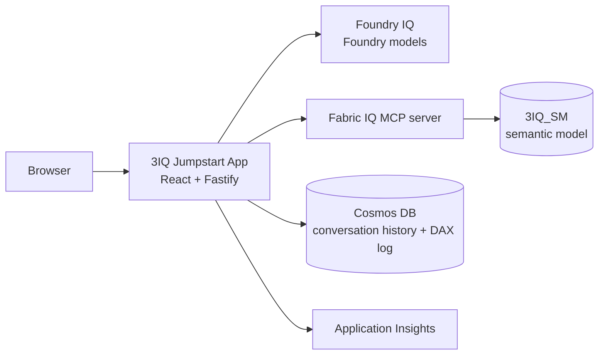
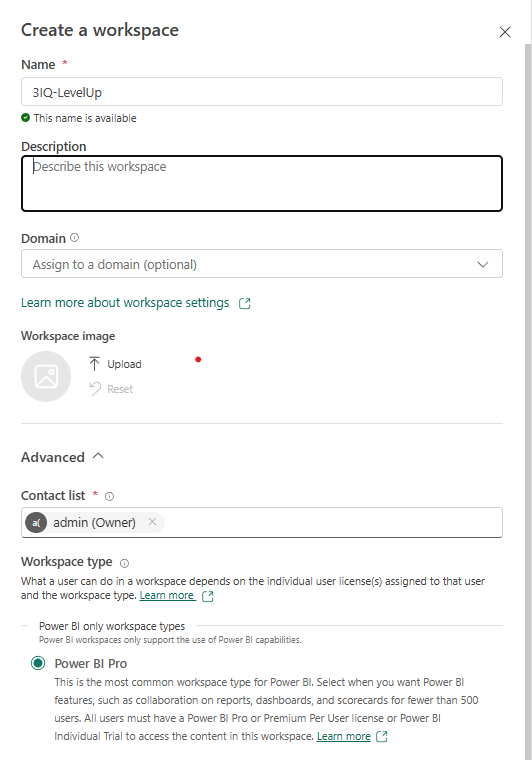
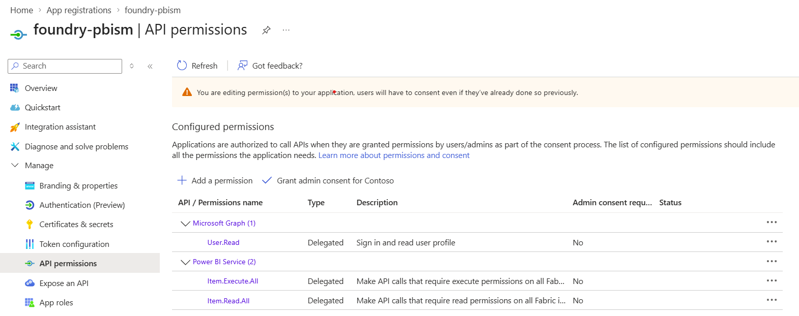
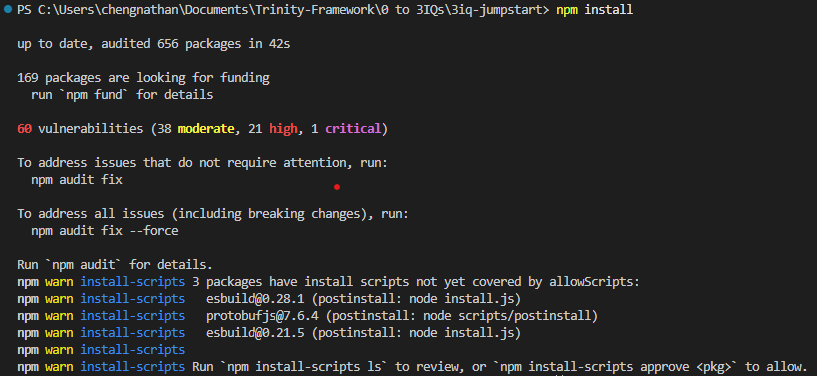

# 00 - Setup Guide (complete before the session)

Ensure to finish all the pre-requisites in this setup guide **before** attempting the Labs.

## What you will build



| Lab | What you do |
|---|---|
| Lab 01 | Publish the `3IQ_SM` semantic model, learn how Fabric IQ MCP reaches it, add a skill |
| Lab 02 | Create the Foundry models, Cosmos DB and Application Insights |
| Lab 03 | Fill in `.env`, run the app locally, test 20 questions |
| Lab 04 | Deploy to Azure Container Apps, review traces, conversation history and API docs |
| Lab 05 | Work IQ (Optional): email and Teams tools through a small Microsoft Graph MCP server (no tenant admin consent, no preview service) |

## Pre-requisites

- **Azure subscription and resource group:** a Microsoft Entra tenant where you have either an Azure subscription or resource group with **Owner** access to create resources.
- **Microsoft Fabric:** 
    - Create a Power BI Pro workspace named `3IQ-LevelUp`
        - 
- **Service principal:**
    - App registration with the following delegated permissions:
        - Microsoft.Graph
            - User.Read
        - Power BI Service
            - Item.Execute.All
            - Item.Read.All
    - 
    - **Note down the Service principal tenant id, client id and client secret. You will use them as the `SPN_TENANT_ID`, `SPN_CLIENT_ID` and `SPN_CLIENT_SECRET` environment variables.**
- **Tools:** Node.js 22 or later (24 LTS recommended), Azure CLI

## Get the code and install dependencies
In VS Code, open a new terminal, run the following commands to clone the 3IQ jumpstart repo and install the required packages.
```powershell
git clone https://github.com/customer-success-microsoft/Trinity-Framework.git
cd ".\0 to 3IQs\3iq-jumpstart\"
npm install
```


---

**Next:** [Lab 01: Semantic Model and Fabric IQ MCP](Lab01-Semantic-Model-and-Fabric-IQ-MCP/Lab01-Semantic-Model-and-Fabric-IQ-MCP.md)

