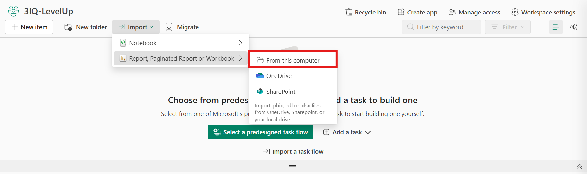
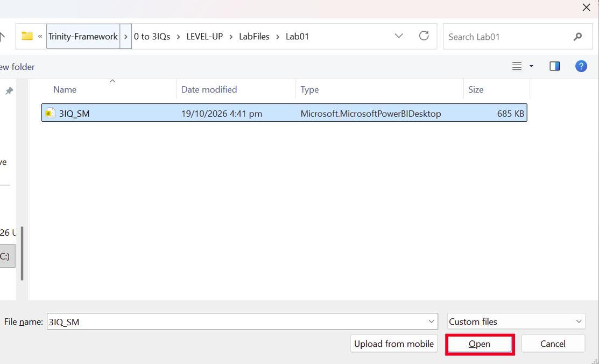
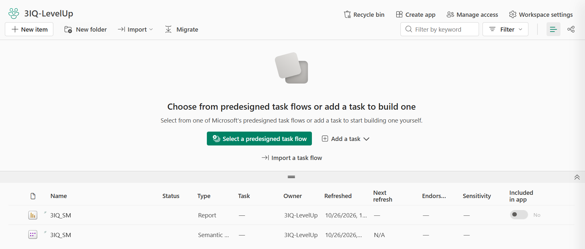
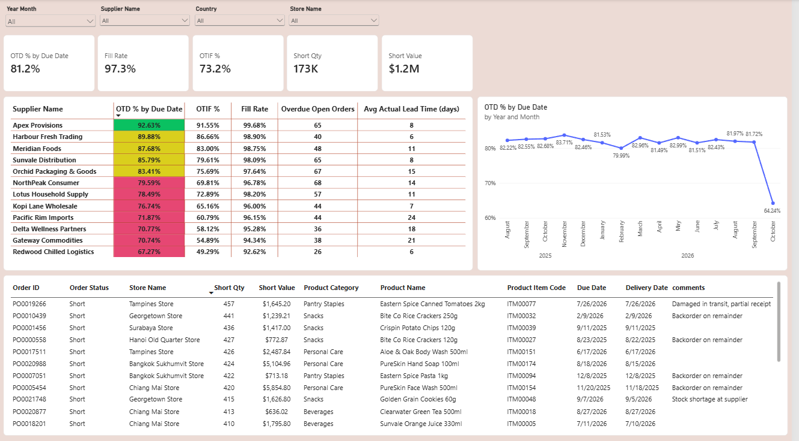
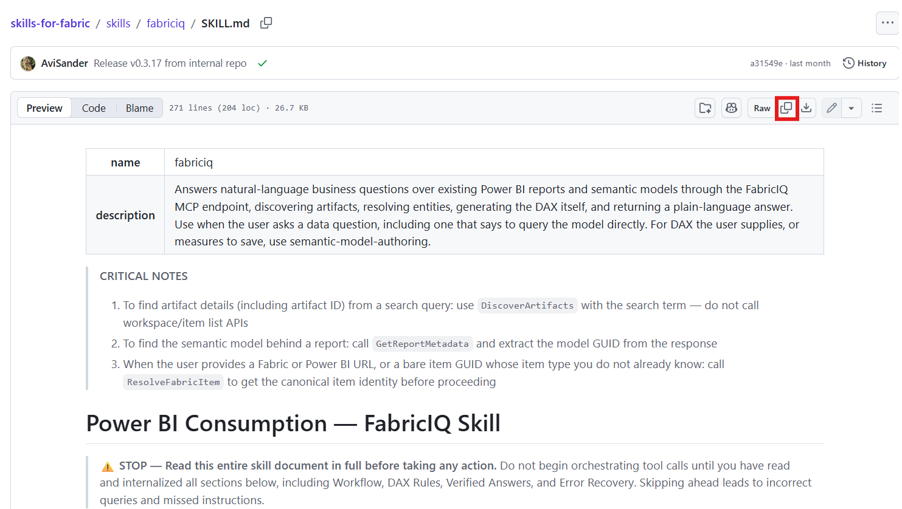
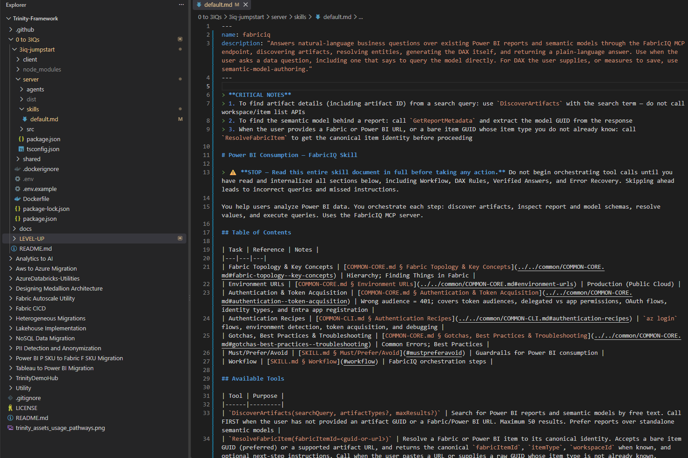

# Lab 01 - Semantic Model, Fabric IQ MCP and Skills

**Time to complete:** 15 minutes

## Objective

Publish the `3IQ_SM` semantic model to Microsoft Fabric, understand how the **Fabric IQ MCP server** lets agents find and query Power BI semantic models and reports, and use the **Fabric IQ skill** that teaches agents how to perform a specific task: explore and query Power BI semantic models and reports the user has access to.

## Pre-requisites

- [Setup Guide](../00-Setup-Guide.md) completed
- `3IQ-LevelUp` Pro-license workspace created

## Section 1: Publish the semantic model

1. Navigate to `3IQ-LevelUp` workspace. Select **Import > Report > From this computer**

2. Upload `LabFiles/Lab01/3IQ_SM.pbix` to the workspace.

3. Once upload is complete, you should see a **semantic model and report** named `3IQ_SM` in the workspace

4. Open the `3IQ_SM` report. It simulates a retail business which sells a wide variety of product categories and SKUs. Imagine yourself as the procurement manager who needs to track **supplier delivery performance** for purchase orders placed with suppliers for stores across Southeast Asia to maintain operational excellence. What kind of questions would you ask, what actions would you take?

## Section 2: Understanding Fabric IQ MCP Server

**MCP (Model Context Protocol)** is an open standard that lets an AI agent connect to external systems. An **MCP server** can publish **tools** (actions the app can call), **resources** (data the app can read) and **prompts** (reusable instruction templates). The **[Fabric IQ MCP server](https://learn.microsoft.com/en-us/fabric/iq/connectors/fabric-iq-mcp)** exposes **tools** listed below, each with a name, a description and the inputs it accepts.

- `DiscoverArtifacts`: search for Power BI reports and semantic models by free text (up to 50 results)
- `ResolveFabricItem`: turn a pasted Fabric or Power BI URL, or an item GUID, into the item's canonical identity
- `GetReportMetadata`: read a report's pages, visuals and filters, and find the semantic model behind it
- `GetSemanticModelSchema`: read tables, columns, measures and relationships, plus the model's custom instructions and verified answers
- `ValueSearch`: find the exact stored value for a name (a product, customer or region) before filtering on it
- `ExecuteQuery`: run one to four DAX queries and return tables (250 rows each by default, 1,000 at most)

The **[Fabric IQ skill](https://github.com/microsoft/skills-for-fabric/blob/main/skills/fabriciq/SKILL.md)** tells the agent the specific workflow: instructions on how to use the tool to explore and query Power BI semantic models.

Key points to remember:

- **Delegated access:** The MCP server accepts only a *signed-in user's* token with the Power BI permissions `Item.Read.All` and `Item.Execute.All`. There is no service principal app only access. Each person only sees data they are allowed to see based on permissions already applied in Power BI, and row-level security is respected.
- **Read-only:** It reads metadata and runs queries, no write functionality
- **The agent generates DAX to query the semantic model.** It inspects the metadata and schema first, then generates and executes DAX queries.

## Section 3: Add the Fabric IQ skill

A **skill** is a markdown file in `server/skills/`. The app adds its text to the agent's instructions (the system prompt) on every request, after the global policies in `server/agents/AGENTS.md`. The app uses the skill named `default` unless a request names another one.

You will replace the contents of `default.md` with the Microsoft Fabric IQ skill, which gives the agent the workflow for exploring and querying Power BI semantic models.

1. Open the [Fabric IQ skill](https://github.com/microsoft/skills-for-fabric/blob/main/skills/fabriciq/SKILL.md) on GitHub and select **Copy raw file**.

2. In VS Code, open `0 to 3IQs/3iq-jumpstart/server/skills/default.md`, select all, and paste to replace the contents. Save the file.

---

**Previous:** [Setup Guide](../00-Setup-Guide.md) | **Next:** [Lab 02: Foundry IQ and Azure Resources](../Lab02-Foundry-IQ-and-Azure-Resources/Lab02-Foundry-IQ-and-Azure-Resources.md)
