# Lab 02 - Azure Resources: Foundry IQ, Cosmos DB and Application Insights

**Time to complete:** 45 minutes

## Objective

Create the three Azure services the app depends on:

| Service | Why the app needs it |
|---|---|
| **Foundry IQ and models** | Hosts the models the agent uses. A Microsoft Foundry resource holds your model deployments, and the app calls them through the Responses API |
| **Azure Cosmos DB for NoSQL** | Uses the **API for NoSQL** (the native document API, queried with SQL-like syntax) in **serverless** capacity mode. Stores conversation history and a log of every DAX query the agent runs, in three containers: `conversations`, `messages` and `daxlog` |
| **Application Insights** | Traces and logs for every request |

## Pre-requisites

- [Setup Guide](../00-Setup-Guide.md) completed
- **Owner** access on either an Azure subscription or resource group to create resources.
- **Microsoft Foundry:** the **Foundry User** role, assigned at the **Foundry resource** scope (the top-level resource that holds the model deployments, not the project inside it). The app calls the resource's endpoint, so the role lets it call the models with your developer Entra sign-in locally. **In Lab 04 this is replaced by the Container App's managed identity**, which gets the same role on the same resource. Contributor and Owner cannot call the models since there is no data plane permission, so this role is needed even if you created the resource.

## Section 1: Create the Foundry resource, deploy two models and setup Application Insights

Use the same resource group and region for every resource in this lab. Choose a region where the model version and deployment option you want to use are available (for example **Sweden Central**). [Region availability for Foundry models](https://learn.microsoft.com/en-us/azure/foundry/foundry-models/concepts/models-sold-directly-by-azure-region-availability?tabs=az-europe&pivots=standard). 

1. In the [Azure portal](https://portal.azure.com) search bar, search for **Microsoft Foundry** and select **Create**.

2. On the **Basics** tab, under **Resource group**, select **Create new** and enter your desired resource group name if there is none existing, for example `threeiqjumpstart`. Enter a name for the resource, choose a region, and enter a project name. Click **Next**.
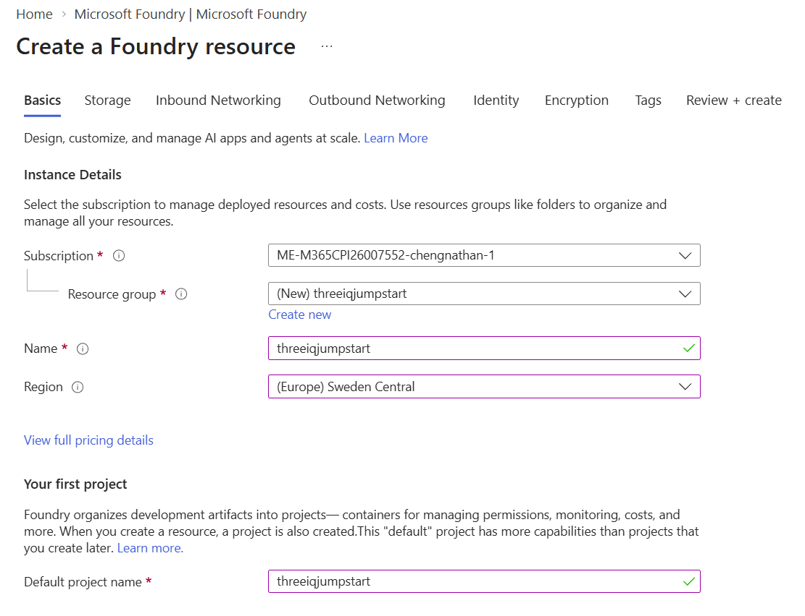

3. On the **Storage** tab, under Credential storage and application logging, **Create new** Azure Key Vault and Application Insights. Leave the rest of the settings as-is and Click **Next**.
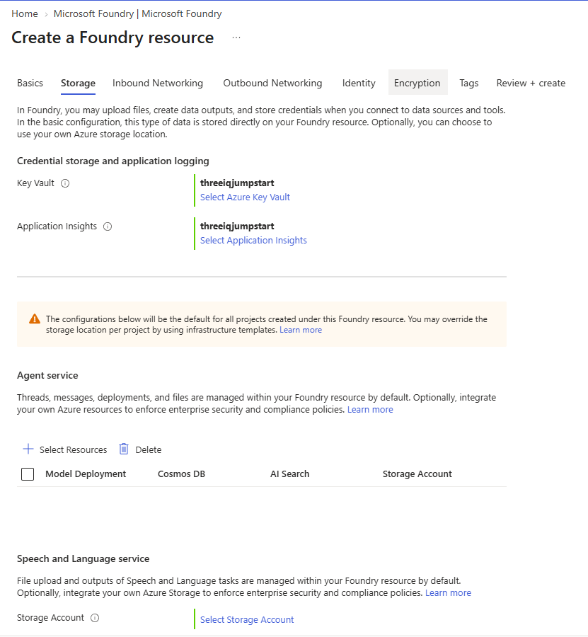

4. Click **Next** through the rest of the settings, leave the rest of the settings as default and Click **Create**.
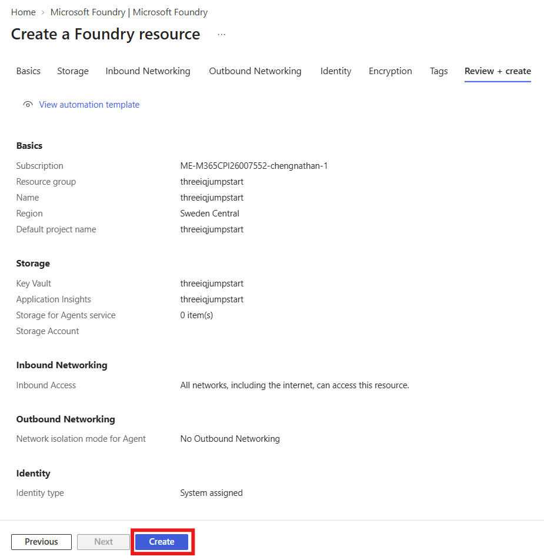

5. When the deployment completes, ensure that you have the **Foundry User** role on the Foundry resource (the top-level resource, not the project).
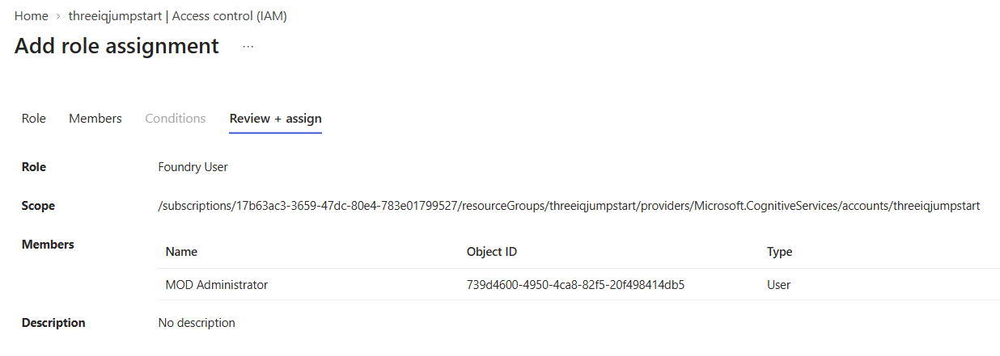

6. Navigate to the **Foundry project** and select **Go to Foundry portal**.
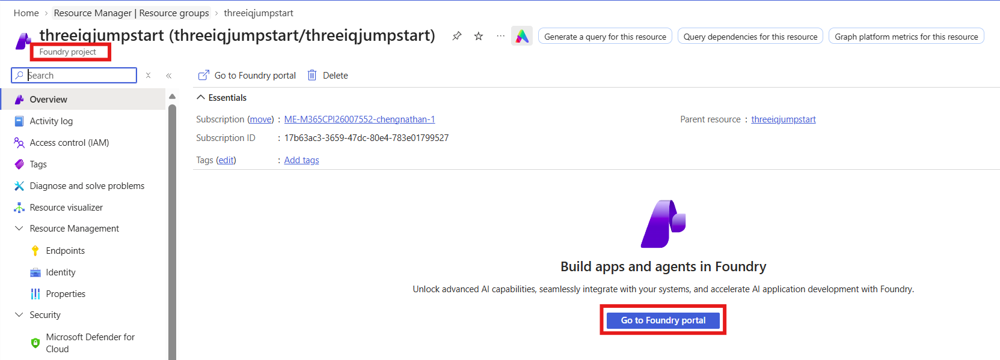

7. On the main page, copy the **Azure OpenAI endpoint**. You will use it as an environment variable later.
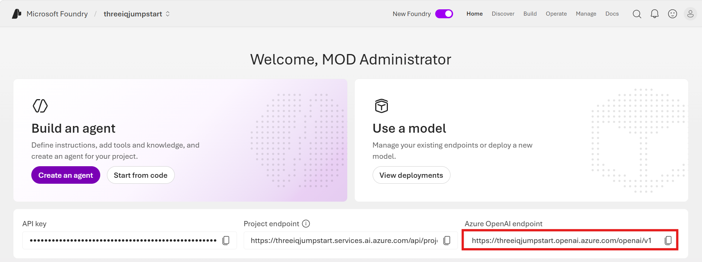

8. Click on **Build** in the Ribbon, then **Models** in the side panel, and on the right select **Deploy > Deploy base model**.
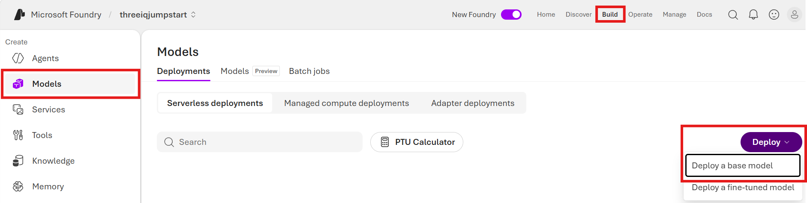

9. On the side panel, expand **Deployment SKU**, and check **Global Standard** Global Standard gives you the widest range of models at PAYG billing model. Choose your first model (for example `gpt-6-sol`).
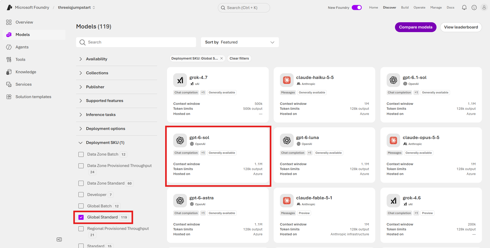

10. Deploy the model with default settings.
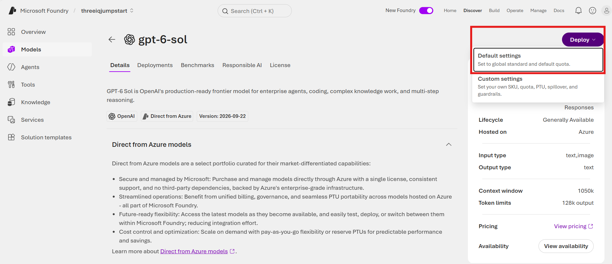

11. Choose another different model to deploy with default settings so that you can use different models in the model picker later. You should end up with 2 different model deployments like below.
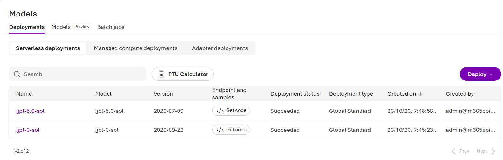 

12. Navigate to the Application Insights resource in the Azure portal. On **Overview**, copy the **Connection String**. You will use it as an environment variable later.
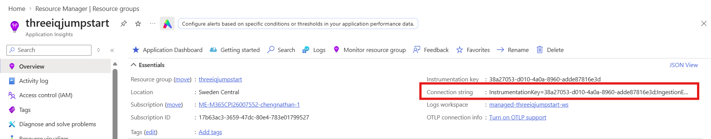

## Section 2: Create Azure Cosmos DB for NoSQL and containers

1. In the portal search bar, search for **Azure Cosmos DB** and select **Create**. Choose **Azure Cosmos DB for NoSQL**.
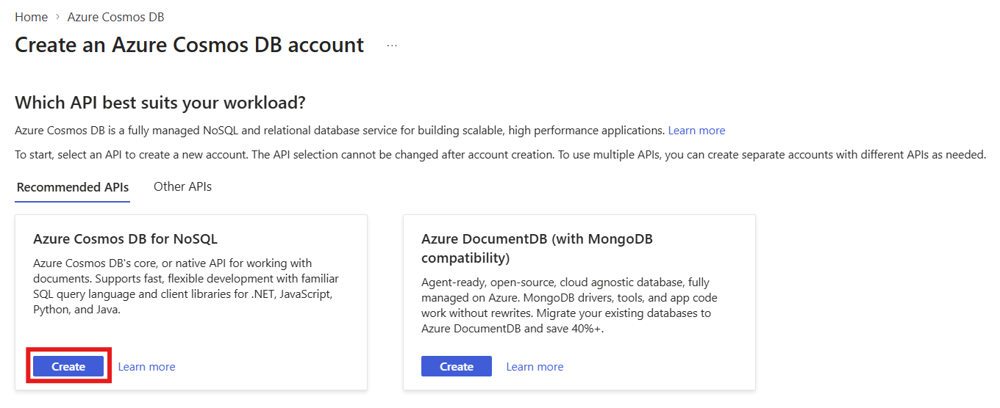

2. On the **Basics** tab, set **Workload Type** to **Development / Testing**, and **Capacity mode** to **Serverless**. Choose a name, and use the same resource group and region you used for the Microsoft Foundry resource., and set **Capacity mode** to **Serverless**. Select **Review + create**, then **Create**.
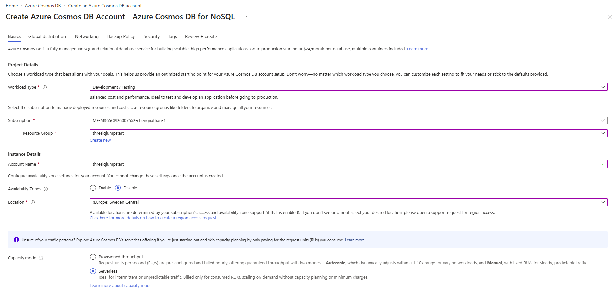

3. Leave the rest of the settings as default and click **Create**.
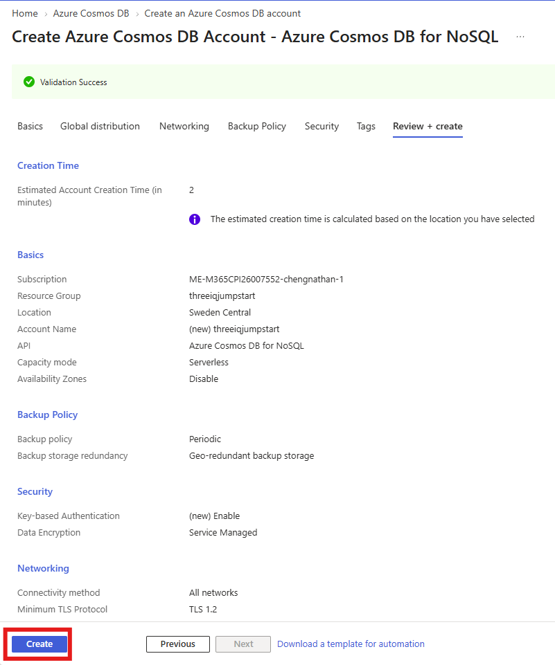

4. When the deployment completes, go to your CosmosDB account and select **Data Explorer**. Select **New Container**. For the first one, choose **Create new** database with the id `threeiq`, enter the container id `conversations` and the partition key `/userId`, then click **OK**.
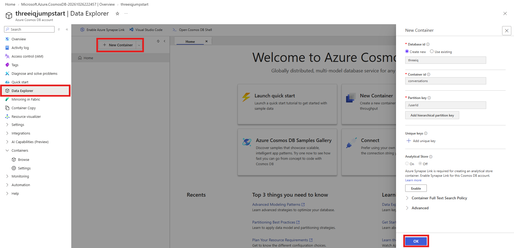

5. Create 2 more containers with **Use existing** database id `threeiq` you already created for the other two containers. Use the exact names and partition keys below. The app depends on them, so check the spelling and capitalization.

   | Container | Partition key | What the app uses it for |
   |---|---|---|
   | `conversations` | `/userId` | **The chat list.** One item per chat: its title, the model used, timestamps, and the id of the last model response so the next question continues the same chat. |
   | `messages` | `/conversationId` | **The chat transcript.** One item per message, user or assistant. Assistant messages also keep the model's name, the DAX queries it ran, and the report or semantic model it used. Opening a past chat loads its messages from here |
   | `daxlog` | `/userId` | **An audit trail of Fabric IQ queries.** One item per tool call the agent makes, with the tool name, the DAX, how long it took, whether it succeeded, who asked and which model. Deleting a chat does not remove its entries, so you can still see what was queried |

   **When you are done, you should have the output below in Data Explorer**
   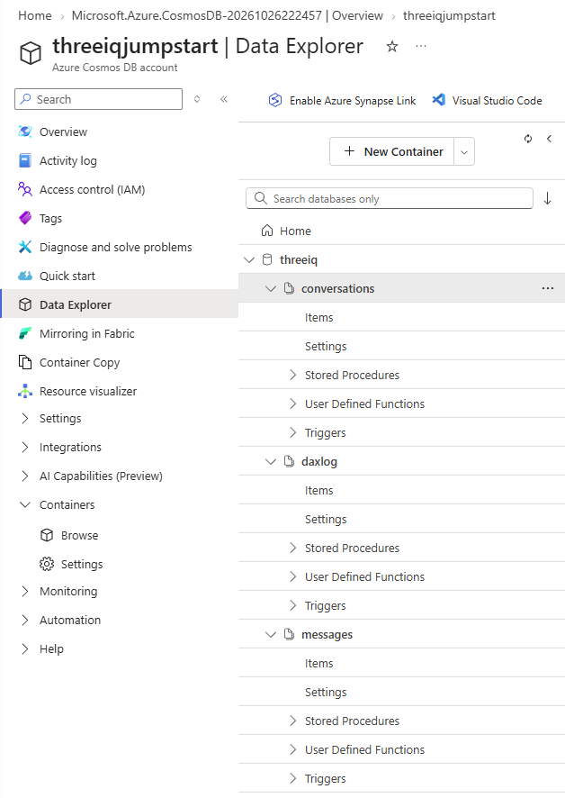

6. Now grant yourself the **Cosmos DB Built-in Data Contributor** role so you can develop locally. The portal's **Access control (IAM)** page does not manage Cosmos DB data roles, so use Azure Cloud Shell. Select the **Cloud Shell** icon at the top of the portal, and choose **PowerShell**
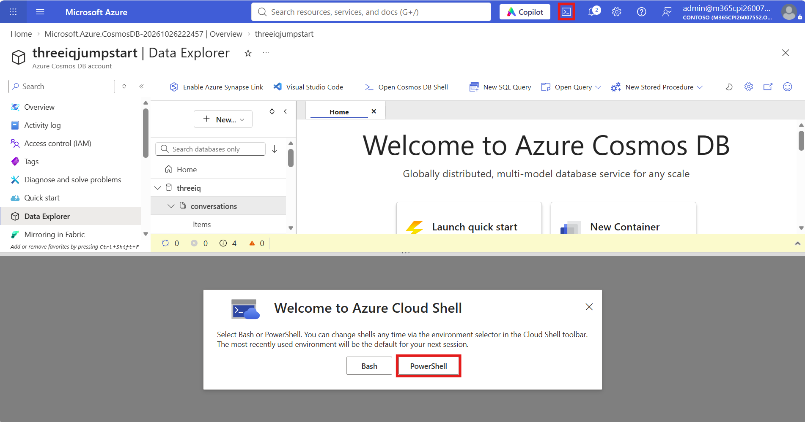

7. Select **No storage account required** and the **subscription** you have been using. Click **Apply**.
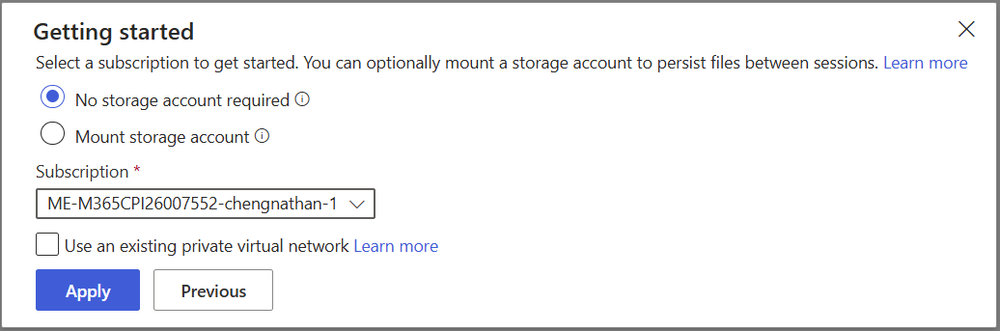

8. **Modify the following script** with your **resource group name** and **CosmosDB account name**, before pasting and running it in **Cloud Shell**.

   ```powershell
   $rg = "<resource-group-name>"
   $cosmos = "<cosmosdb-account-name>"
   $me = az ad signed-in-user show --query id -o tsv
   az cosmosdb sql role assignment create --account-name $cosmos --resource-group $rg `
     --role-definition-name "Cosmos DB Built-in Data Contributor" --principal-id $me --scope "/"
   ```
   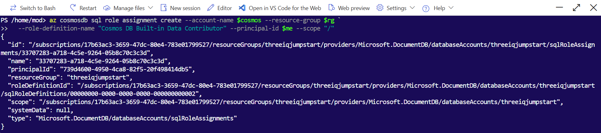

## Section 3: Collect the values for your .env file

Note these values down. You will use them in Lab 03, where you fill in the `.env` file.

| `.env` variable | Where to find it |
|---|---|
| `AZURE_OPENAI_ENDPOINT` | Foundry portal home page |
| `MODEL_DEPLOYMENT_NAME` | The name of your first model deployment e.g. `gpt-6-sol` |
| `MODEL_DEPLOYMENTS` | All deployment names for the model picker, as `deployment:Label`, comma-separated, e.g. `gpt-6-sol:GPT-6 sol,gpt-5.6-sol:GPT-5.6 sol` |
| `SPN_TENANT_ID` | Your Entra tenant (directory) ID. See [00-Setup-Guide](../00-Setup-Guide.md) |
| `SPN_CLIENT_ID` | The app registration's Application (client) ID. See [00-Setup-Guide](../00-Setup-Guide.md) |
| `SPN_CLIENT_SECRET` | The app registration's client secret value. See [00-Setup-Guide](../00-Setup-Guide.md) |
| `COSMOS_ENDPOINT` | Cosmos DB account > **Overview** > **URI** |
| `COSMOS_DATABASE` | `threeiq` |
| `APPLICATIONINSIGHTS_CONNECTION_STRING` | Application Insights > **Overview** > **Connection String** |

> `MODEL_DEPLOYMENT_NAME` and every deployment name must match the deployment names exactly, including case.

---

**Previous:** [Lab 01: Semantic Model and Fabric IQ MCP](../Lab01-Semantic-Model-and-Fabric-IQ-MCP/Lab01-Semantic-Model-and-Fabric-IQ-MCP.md) | **Next:** [Lab 03: Run Locally and Test](../Lab03-Run-Locally-and-Test/Lab03-Run-Locally-and-Test.md)

