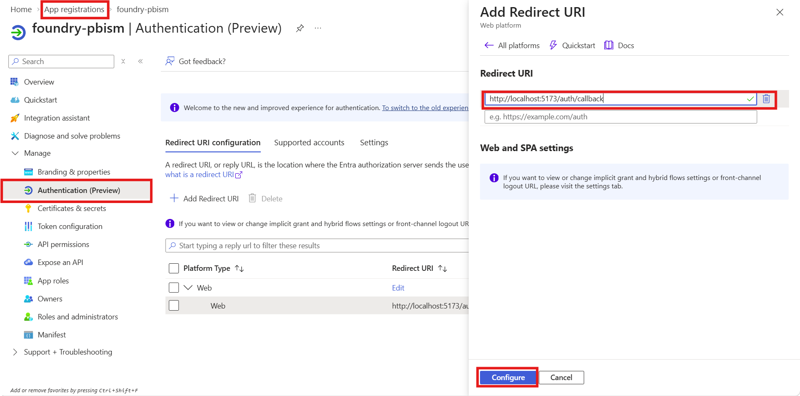
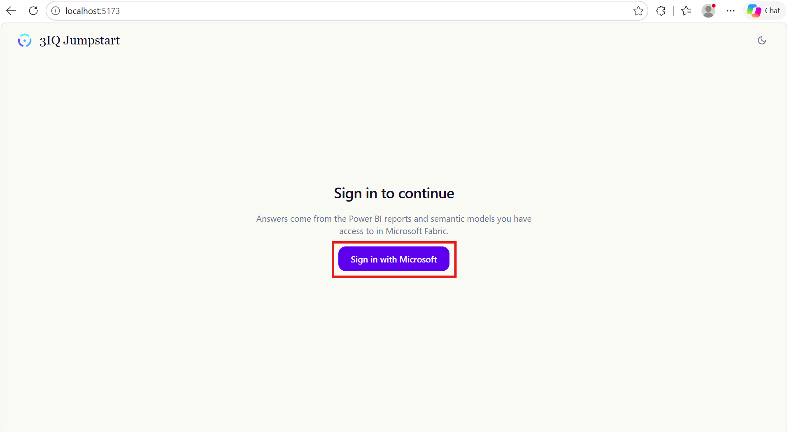
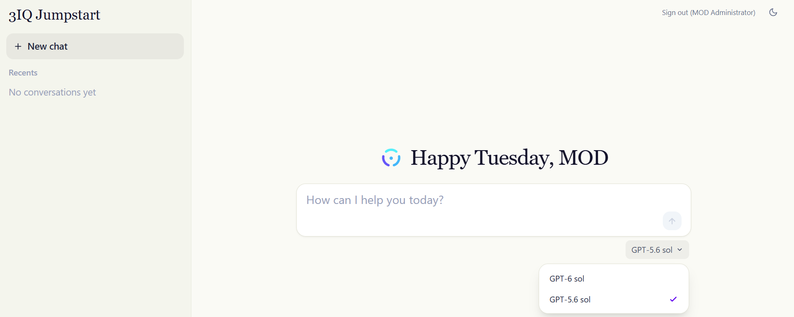
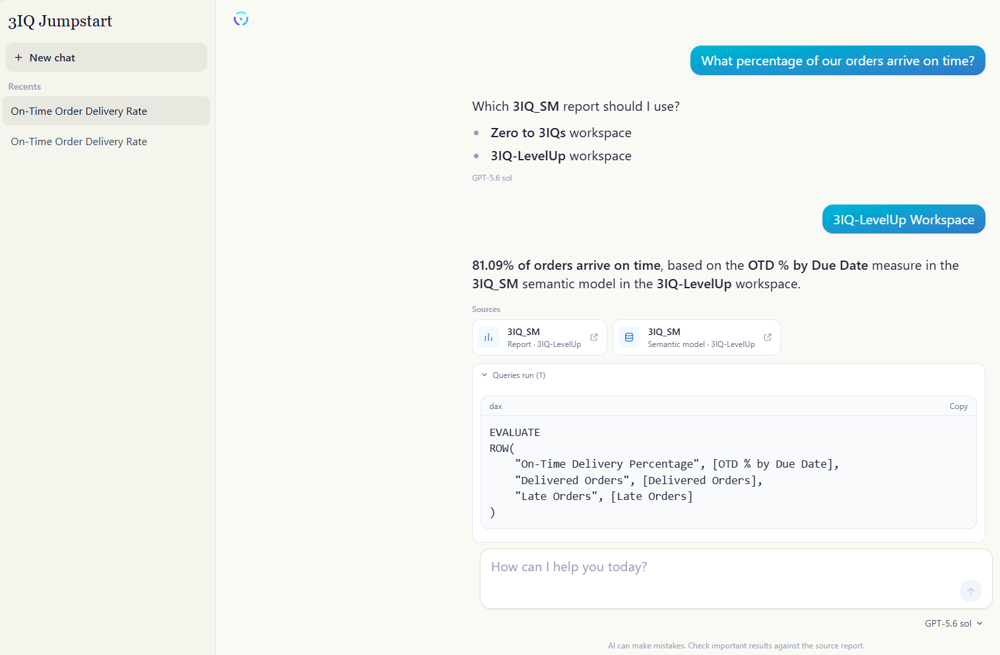
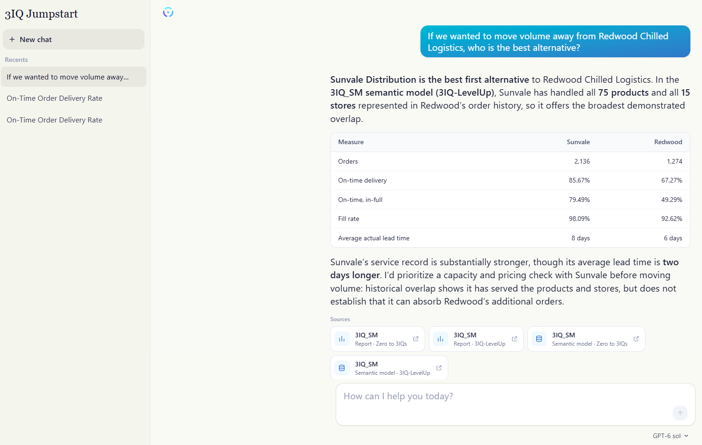

# Lab 03 - Run locally and test

**Time:** 30 minutes

## Objective

Connect the pieces: Check the service principal, fill in the environment variables, run the 3IQ Jumpstart app on your local machine, then test it with 20 questions. You will inspect the DAX the agent writes and compare two models.

## Pre-requisites
- [Lab 02](../Lab02-Foundry-IQ-and-Azure-Resources/Lab02-Foundry-IQ-and-Azure-Resources.md) completed: environment variables collected

## Section 1: Add redirect URI to service principal
1. In the [Azure portal](https://portal.azure.com), search for **App registrations**, navigate to your **service principal** which you created in the [Setup Guide](../00-Setup-Guide.md) and click on **Authentication** in the side panel. **Add Redirect URI**, choose platform **Web** and enter `http://localhost:5173/auth/callback`. Click **Configure**.


## Section 2: Fill in the environment variables
1. Open a new terminal in VS Code, and create your `.env` file:

   ```powershell
   cd ".\0 to 3IQs\3iq-jumpstart\"
   Copy-Item ..\LEVEL-UP\LabFiles\Lab03\.env.example .env
   ```

2. Open `.env` in VS Code and replace every `<placeholder>`, along with the model deployments you created in [Lab 02](../Lab02-Foundry-IQ-and-Azure-Resources/Lab02-Foundry-IQ-and-Azure-Resources.md):


   | `.env` Variable | Where the value comes from |
   |---|---|
   | `AZURE_OPENAI_ENDPOINT`, `MODEL_DEPLOYMENT_NAME`, `MODEL_DEPLOYMENTS` | [Lab 02](../Lab02-Foundry-IQ-and-Azure-Resources/Lab02-Foundry-IQ-and-Azure-Resources.md) output |
   | `SPN_TENANT_ID`, `SPN_CLIENT_ID`, `SPN_CLIENT_SECRET` | [Setup Guide](../00-Setup-Guide.md) output |
   | `APP_BASE_URL` | Leave as `http://localhost:5173` |
   | `PORT` | Leave as `8080` |
   | `NODE_ENV` | Leave as `development` |
   | `COSMOS_ENDPOINT`, `COSMOS_DATABASE` | [Lab 02](../Lab02-Foundry-IQ-and-Azure-Resources/Lab02-Foundry-IQ-and-Azure-Resources.md) output |
   | `APPLICATIONINSIGHTS_CONNECTION_STRING` | [Lab 02](../Lab02-Foundry-IQ-and-Azure-Resources/Lab02-Foundry-IQ-and-Azure-Resources.md) output |

   > **Cosmos DB must be publicly accessible.** In the Cosmos DB account, open **Settings** > **Networking** and make sure public network access is enabled for **All networks**. Otherwise the app cannot reach it and conversation history will not work.

## Section 3: Run the app locally

1. Sign in using your Entra ID account so the server can use your Azure identity for Fabric IQ MCP server, Foundry models and Cosmos DB:

   ```powershell
   az login --use-device-code
   ```

2. Open a new terminal, and start the backend:

   ```powershell
   cd ".\0 to 3IQs\3iq-jumpstart\"
   npm run dev:server
   ```

3. Open a new terminal, and start the frontend:

   ```powershell
   cd ".\0 to 3IQs\3iq-jumpstart\"
   npm run dev:client
   ```
4. Open http://localhost:5173 in a web browser. Select **Sign in with Microsoft** and consent for the app to act on your behalf.
   

5. After sign-in you should see the home screen with the model picker below the input box.
   

## Section 4: Ask a first question and inspect the DAX
1. Open [test-questions.md](../LabFiles/Lab03/test-questions.md).
2. Start with asking a simple first question.

3. While it runs, watch the status messages, for example "Connecting to Fabric IQ...", "Reading semantic model schema...", "Running query on semantic model...". These are the instructions and tool calls the AI Agent is running through.

4. When the answer appears, check under it for:
   - **Sources**: a link to the `3IQ_SM` semantic model
   - **Queries run (N)**: expand it to see the DAX the agent wrote
   - *Outputs may vary, expected answers in [test-questions.md](../LabFiles/Lab03/test-questions.md) are illustrative.*
   

5. **Compare the DAX with the reference DAX and expected answer in [test-questions.md](../LabFiles/Lab03/test-questions.md)**. 

## Section 5: Switch to a different model in the model picker. Run through 20 questions with the LLM of your choice.
1. **Switch to your other model in the model picker. Run through a mixture of easy, medium, hard questions from Q01-Q20.**
   - *Outputs may vary, expected answers in [test-questions.md](../LabFiles/Lab03/test-questions.md) are illustrative.*
   

---

**Previous:** [Lab 02: Foundry IQ and Azure Resources](../Lab02-Foundry-IQ-and-Azure-Resources/Lab02-Foundry-IQ-and-Azure-Resources.md) | **Next:** [Lab 04: Deployment and Observability](../Lab04-Deployment-and-Observability/Lab04-Deployment-and-Observability.md)

