# Lab 04: Deployment and Observability

**Time:** 60 minutes

## Objective

Deploy the 3IQ Jumpstart app to **Azure Container Apps**, monitor its performance and trace requests with **Application Insights**, review the **conversation history and DAX log** in Cosmos DB, and explore the **auto-generated API docs**.

## Prerequisites
- [Lab 03](../Lab03-Run-Locally-and-Test/Lab03-Run-Locally-and-Test.md) completed: managed to run the app successfully on your localhost.
- `az login` done in [Lab 03](../Lab03-Run-Locally-and-Test/Lab03-Run-Locally-and-Test.md) , on the same tenant as your [Lab 02](../Lab02-Foundry-IQ-and-Azure-Resources/Lab02-Foundry-IQ-and-Azure-Resources.md) resources.

## Section 1: Create the container registry and build the container image
1. In the [Azure portal](https://portal.azure.com) search bar, search for **Container registries** and select **Create**.

2. On the **Basics** tab, select the same subscription and the resource group you used previously. Enter a **Registry name**, for example `threeiqjumpstart`, and choose the same **Location** as your other resources. Leave **Domain name label scope** as **Unsecure**, set **Pricing plan** to **Basic**, and **Role assignment permissions mode** to **RBAC Registry Permissions**.
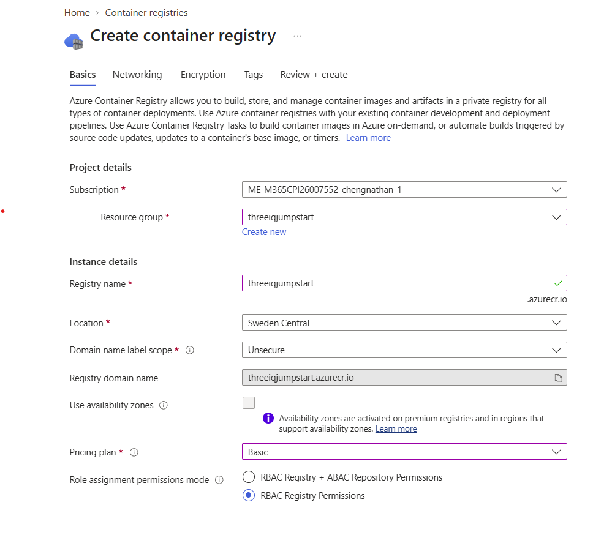

3. Leave all other settings as default and click **Create**.
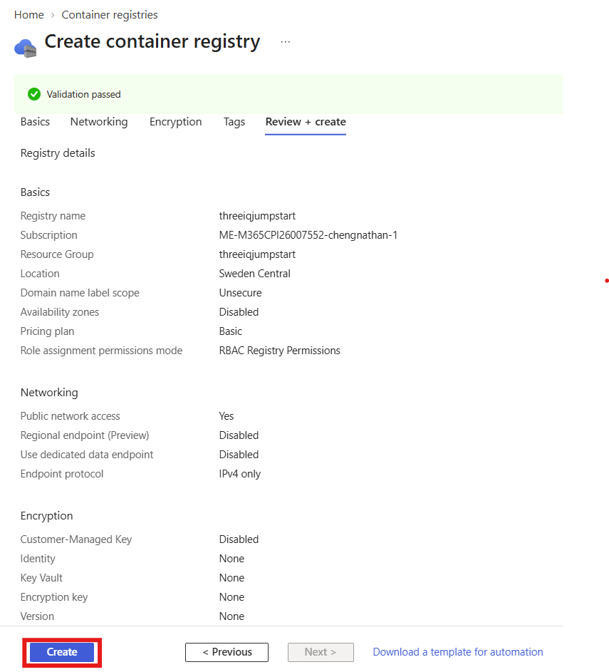

4. We will build the container image in Azure Container registry, so Docker is not needed on your machine. Open a new terminal in VS Code and run:

   ```powershell
   $src = Join-Path $env:TEMP "3iq-build"
   robocopy ".\0 to 3IQs\3iq-jumpstart" $src /MIR /XD node_modules dist .git /XF .env ".env.*" /NFL /NDL /NJH /NJS /NP
   $LASTEXITCODE
   ```

   The command prints no output while copying. `$LASTEXITCODE` shows the `robocopy` exit code: `1` means the files were copied, `0` means nothing changed since the last run, and any value below 8 means success. The terminal may show a red marker for a non-zero exit code, which you can ignore here. You can re-run the command at any time: `/MIR` makes the build folder an exact copy of the source.
   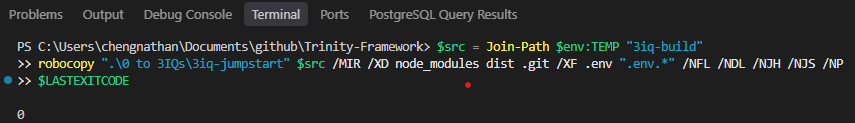

5. Build and publish the conatiner image in your registry. Replace `<registry-name>` with the container registry name you entered in step 2, for example `threeiqjumpstart`:

   ```powershell
   az acr build --registry <registry-name> --image 3iq-jumpstart:v1 $src --no-logs
   ```

   The command takes a few minutes until the build finishes. `--no-logs` avoids an Azure CLI crash while streaming build logs on some Windows consoles.

   When the build finishes, the command prints the run result as JSON. Check that `outputImages` lists the `3iq-jumpstart` repository with the tag `v1`, and that `provisioningState` is `Succeeded`.
   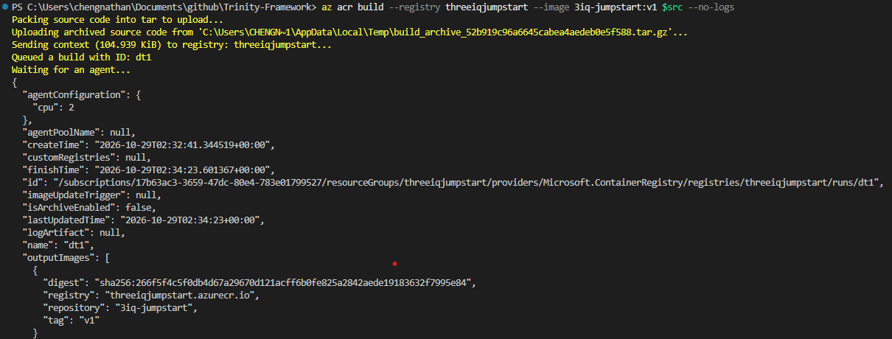

6. In the portal, open the registry and select **Services > Repositories**. You should see `3iq-jumpstart` with the tag `v1`.
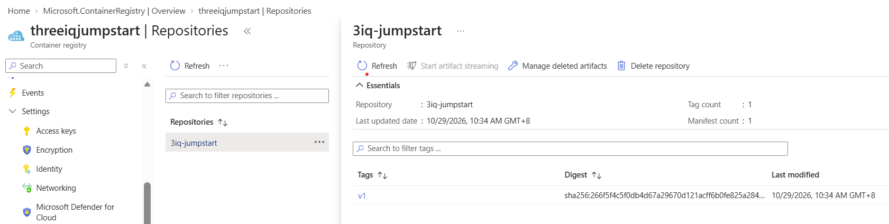

## Section 2: Store the sensitive values in Azure Key Vault
Store the sensitive values from your `.env` (the service principal details and the Application Insights connection string) in the Azure Key Vault that was created in [Lab 02](../Lab02-Foundry-IQ-and-Azure-Resources/Lab02-Foundry-IQ-and-Azure-Resources.md).

1. In the [Azure portal](https://portal.azure.com), navigate to the **Key Vault** that was created with your Foundry resource in Lab 02.

2. Let yourself create secrets. Open **Access control (IAM)** > **Add > Add role assignment**. On the **Role** tab select **Key Vault Secrets Officer**, then **Next**. Select **User, group, or service principal**, then **Select members** and choose your user. Click **Review + assign**.
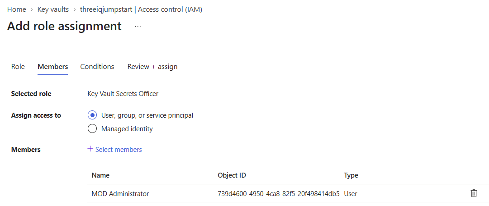

3. Open **Objects > Secrets** and select **Generate/Import**. Create the following four secrets one at a time, pasting the value from your `.env`. Leave the other settings as default and select **Create** each time.

   | Secret name | Value from `.env` |
   |---|---|
   | `spn-tenant-id` | `SPN_TENANT_ID` |
   | `spn-client-id` | `SPN_CLIENT_ID` |
   | `spn-client-secret` | `SPN_CLIENT_SECRET` |
   | `appinsights-connection-string` | `APPLICATIONINSIGHTS_CONNECTION_STRING` |

   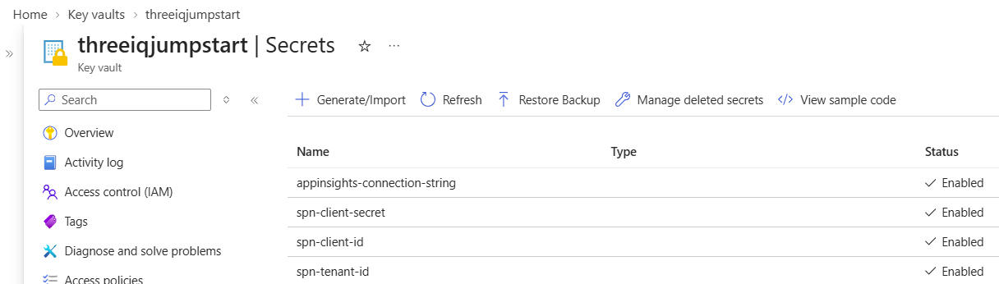

5. Open the Key Vault **Overview** page and note down the **Vault URI**, for example `https://<vault-name>.vault.azure.net/`. You will use this later.
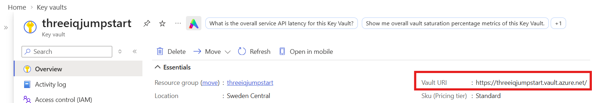

## Section 3: Deploy to Azure Container Apps
You will create the Container App, give its managed identity access to the Azure resources, and configure it with the Key Vault secrets and the other values from your `.env`.

### Create the Container App

1. In the portal, search for **Container Apps** and select **Create > Container App**.
2. On the **Basics** tab, choose your subscription and resource group, and enter a name for the Container App, for example `threeiqjumpstart`. Set **Deployment source** to **Container image** and choose the same region you used previously.
3. Under **Container Apps environment**, select **Create new**, enter a name for the environment, for example `threeiqjumpstart`, keep the defaults.
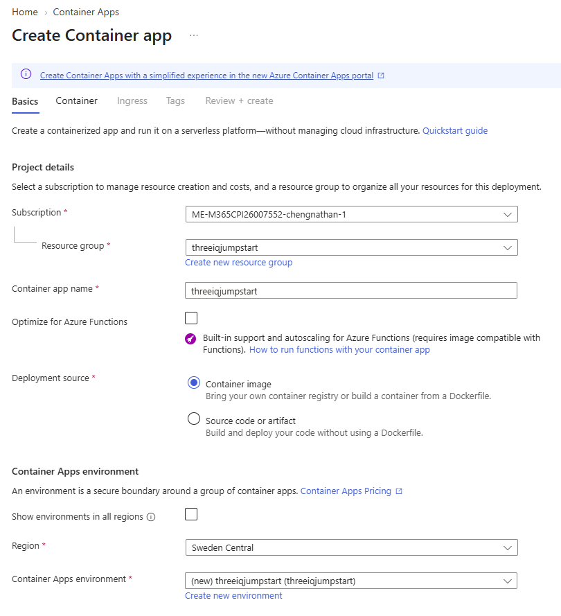

4. On the **Container** tab, check **Use quickstart image**. We must create the container app first, to create the managed identity and assign it permissions before it can pull our `3iq-jumpstart` image.
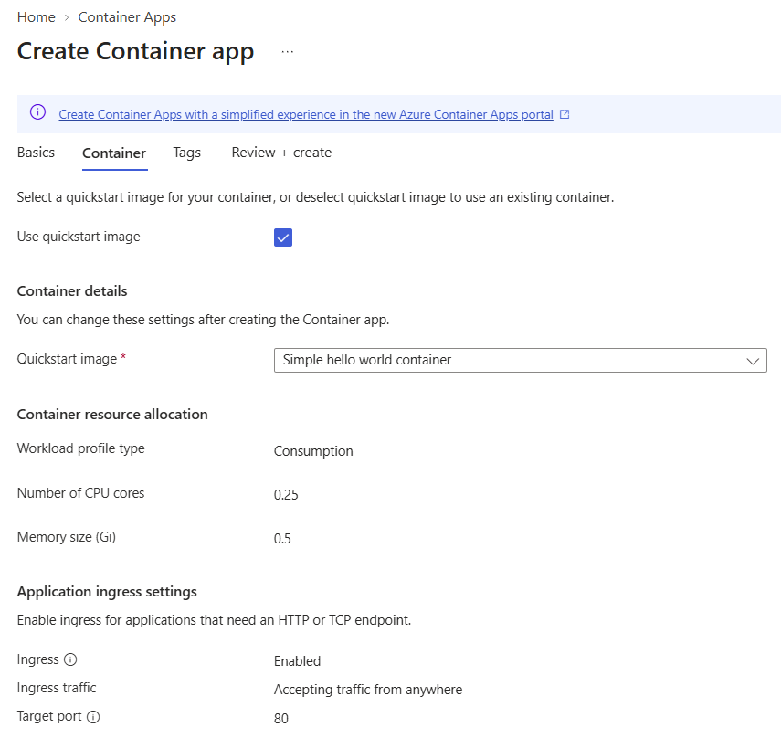

5. Leave all other settings as default and click **Create**.
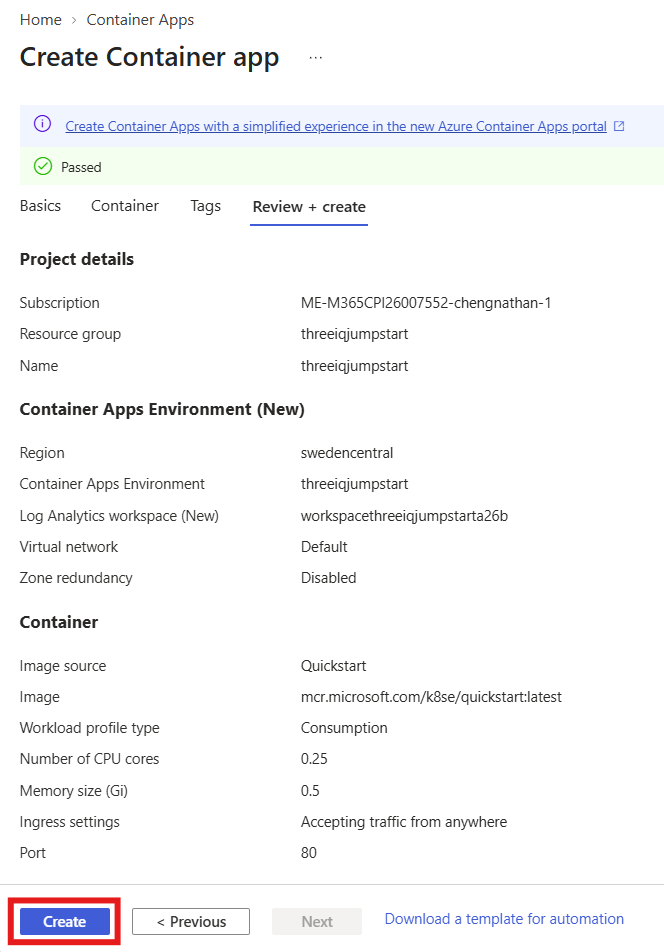

### Grant the Container App access to Azure resources

1. Navigate to the Container App, and open **Security > Identity**. On the **System assigned** tab set **Status** to **On**, and click **Save** and **Yes** to confirm. Copy the **Object (principal) ID** and note it down.
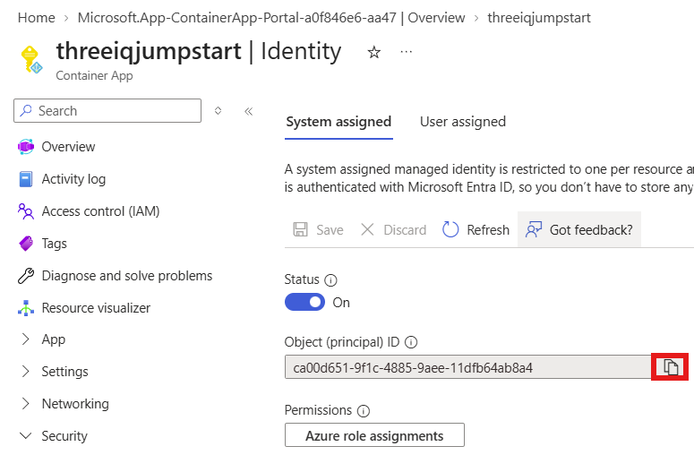

2. Let the app pull from your registry. Open the **container registry** > **Access control (IAM)** > **Add > Add role assignment**. On the **Role** tab select **AcrPull**, then **Next**. For **Assign access to** select **Managed identity**, then **Select members**. Choose your subscription, select your **Container App**, validate the **Object (principal) id** then click **Review + assign**.
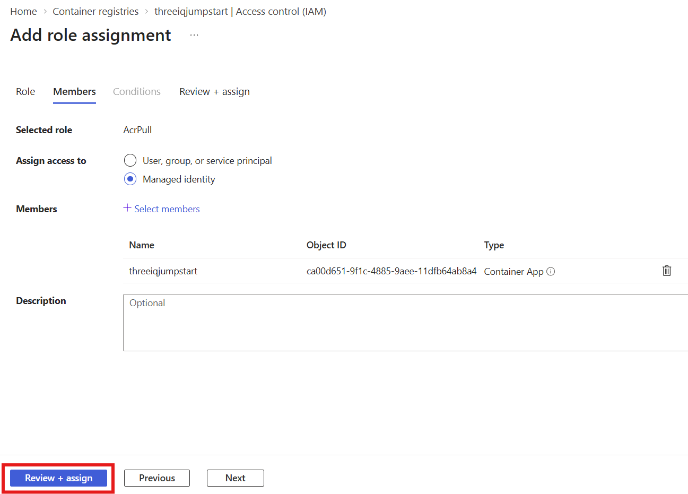

3. Let the app read Key Vault secrets. Repeat step 2 on the **Key Vault**, assign the role **Key Vault Secrets User** to the managed identity.
4. Let the app call Foundry models. Repeat step 2 on the **Foundry resource** (the top-level resource, not the project), assign the role **Foundry User** to the managed identity.

5. Let the app read and write to Cosmos DB. This is a data-plane role, so assign it in **Azure Cloud Shell** (PowerShell), same as in [Lab 02](../Lab02-Foundry-IQ-and-Azure-Resources/Lab02-Foundry-IQ-and-Azure-Resources.md). Replace the values, using the Object (principal) ID copied in step 1:

   ```powershell
   $rg = "<resource-group-name>"
   $cosmos = "<cosmosdb-account-name>"
   $principalId = "<object-principal-id>"

   az cosmosdb sql role assignment create --account-name $cosmos --resource-group $rg `
     --role-definition-name "Cosmos DB Built-in Data Contributor" --principal-id $principalId --scope "/"
   ```

### Configure and deploy the app

1. Reference the secrets. In the Container App, open **Security > Secrets**. For each row below, select **Add**, enter the key, set the type to **Key Vault reference**, enter the Key Vault secret URL, select the **System assigned** managed identity, and click **Add**.

   | Key | Key Vault secret URL |
   |---|---|
   | `spn-tenant-id` | `https://<vault-name>.vault.azure.net/secrets/spn-tenant-id` |
   | `spn-client-id` | `https://<vault-name>.vault.azure.net/secrets/spn-client-id` |
   | `spn-client-secret` | `https://<vault-name>.vault.azure.net/secrets/spn-client-secret` |
   | `appinsights-connection-string` | `https://<vault-name>.vault.azure.net/secrets/appinsights-connection-string` |

   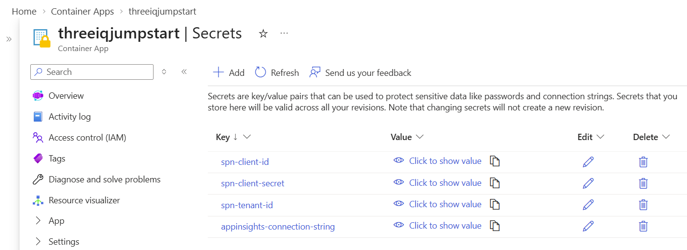

2. Open **Networking > Ingress** and change **Target port** to `8080`. Click **Save**.
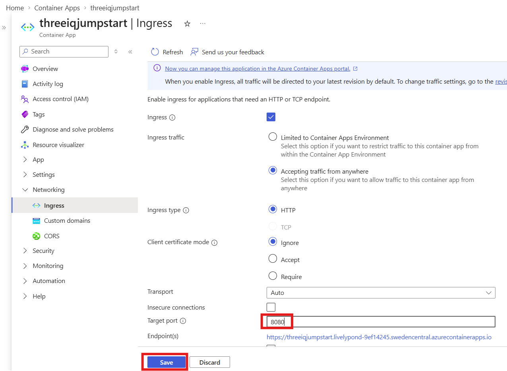

3. Open **App > Containers**, on the Properties tab, set:
   - **Name**: `3iq-jumpstart`
   - **Image source**: **Azure Container Registry**
   - **Authentication**: **Managed identity**
   - **Identity**: **System assigned** under **App level system-assigned managed identity**
   - **Registry**: select your registry you created in Section 1
   - **Image**: `3iq-jumpstart`
   - **Image tag**: `v1`
   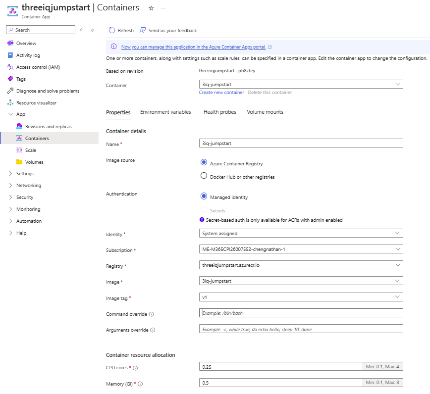

4. On the **Environment variables** tab: add the following. Copy the values from your `.env` file where specified.

   | Name | Source | Value |
   |---|---|---|
   | `AZURE_OPENAI_ENDPOINT` | Manual entry | From `.env` |
   | `MODEL_DEPLOYMENT_NAME` | Manual entry | From `.env` |
   | `MODEL_DEPLOYMENTS` | Manual entry | From `.env` |
   | `SPN_TENANT_ID` | Reference a secret | `spn-tenant-id` |
   | `SPN_CLIENT_ID` | Reference a secret | `spn-client-id` |
   | `SPN_CLIENT_SECRET` | Reference a secret | `spn-client-secret` |
   | `APP_BASE_URL` | Manual entry | The **Application Url** on the Container App **Overview** page, for example `https://nc42-3iq.<random>.swedencentral.azurecontainerapps.io`, with no trailing slash |
   | `COSMOS_ENDPOINT` | Manual entry | From `.env` |
   | `COSMOS_DATABASE` | Manual entry | `threeiq` |
   | `APPLICATIONINSIGHTS_CONNECTION_STRING` | Reference a secret | `appinsights-connection-string` |
   | `NODE_ENV` | Manual entry | `production` |
   | `PORT` | Manual entry | `8080` |

   Select **Save as a new revision**.

5. Open the **Scale** tab and set **Min replicas** and **Max replicas** to `1`.

### Add the redirect URI

1. In the portal, search for **App registrations**, open your **service principal** and select **Authentication**.
2. **Add Redirect URI**, select **Web**, and enter `https://<container-app-url>/auth/callback`, using the Application Url from the Container App **Overview** page. Keep the `http://localhost:5173/auth/callback` entry. Click **Configure**.
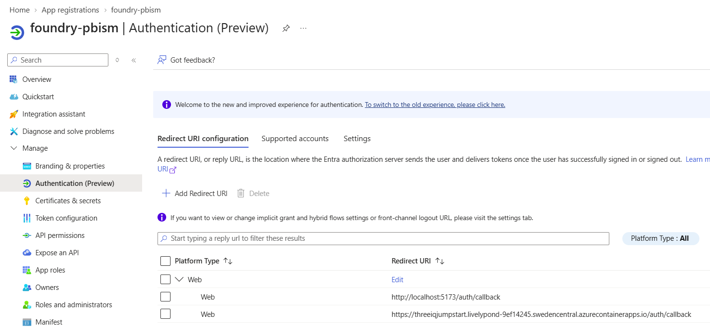

## Section 4: Verify the deployment and explore the app

### Verify the deployment

1. In the [Azure portal](https://portal.azure.com), open your Container App **Application Url**. Sign in with your Entra ID account and test the app by starting a new chat and asking questions about the semantic model.
   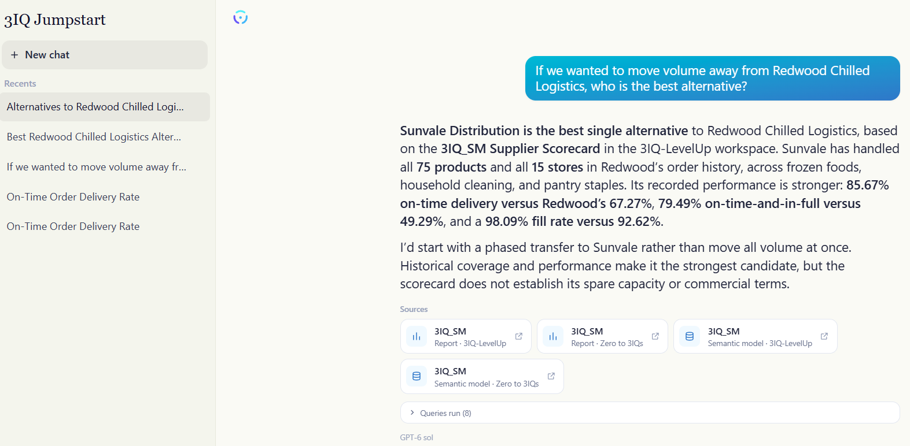

### Application Insights Observability

Observability is wired to the `APPLICATIONINSIGHTS_CONNECTION_STRING` setting. It records every incoming request, outgoing HTTP call so you have full visibility into how long each model call and Fabric IQ MCP server tool call took.

1. In the Azure portal, open **Application Insights**.
2. Open **Investigate > Search**. In the list of results, select the `POST /api/chat` request that matches the chat you just ran.
3. The **End-to-end transaction details** page opens. The first row is the incoming `POST /api/chat` request and its total duration. The rows below it are everything the app called to answer your question, with the bars on the right showing when each call started and how long it took.
   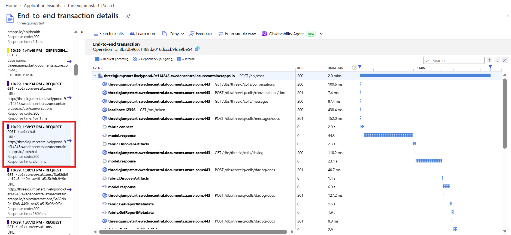

### Review the conversation history and DAX log

1. In the Azure portal, open the Cosmos DB account and select **Data Explorer**. Open the `threeiq` database, explore the data logged in the containers: `conversations`, `daxlog`, `messages`.
   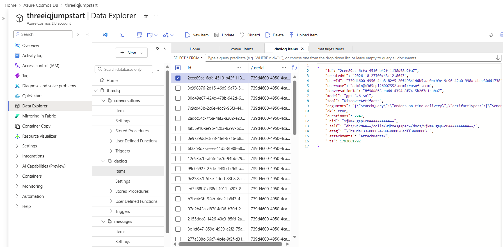

   > **Data Explorer shows "AAD token does not exist", or the Entra ID sign-in pop-up says `login.microsoftonline.com` refused to connect?** This usually happens when a browser extension, proxy or network policy blocks the sign-in pop-up. Use the [Azure Cosmos DB extension](https://marketplace.visualstudio.com/items?itemName=ms-azuretools.vscode-cosmosdb) in VS Code instead: install it, sign in to Azure from the **Azure** view, expand your Cosmos DB account under **Databases**, and browse the `threeiq` database and its `conversations`, `daxlog` and `messages` containers. The extension signs in with your Entra ID account and needs the same Cosmos DB data role you already use locally.

### Explore the auto-generated API docs

The server publishes interactive API documentation.

1. Go to `https://<container-app-url>/docs`.
2. Expand and read these endpoints:

   | Endpoint | Purpose |
   |---|---|
   | `POST /api/chat` | Streams an answer as server-sent events. Body: `message`, and optionally `model`, `skill`, `conversationId` |
   | `GET /api/conversations` | The signed-in user's recent conversations |
   | `GET /api/conversations/{id}` | One conversation with its messages |
   | `DELETE /api/conversations/{id}` | Delete a conversation and its messages |
   | `GET /api/models` | The models in the picker |
   | `GET /api/skills` | Available skills |
   | `GET /api/auth/me` | Sign-in state |
   | `GET /auth/login`, `GET /auth/callback`, `POST /auth/logout` | Microsoft sign-in flow and sign-out |
   | `GET /api/health` | Liveness check |

3. Select **Try it out** on `GET /api/models` and `GET /api/health`, then **Execute**.
   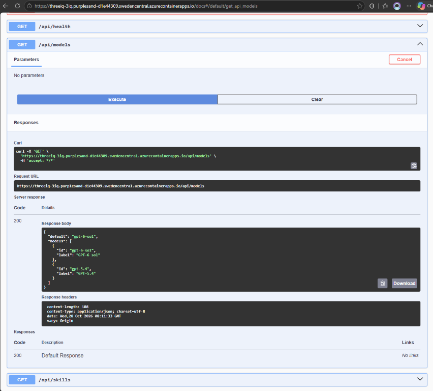

> `/docs` is public in this sample. Before a real deployment, decide whether to restrict or disable it.

---

**Previous:** [Lab 03: Run Locally and Test](../Lab03-Run-Locally-and-Test/Lab03-Run-Locally-and-Test.md) | **Next (optional):** [Lab 05: Work IQ (Optional)](../Lab05-Work-IQ-Optional/Lab05-Work-IQ-Optional.md)

