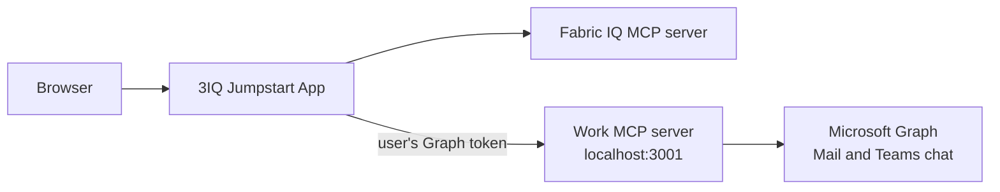
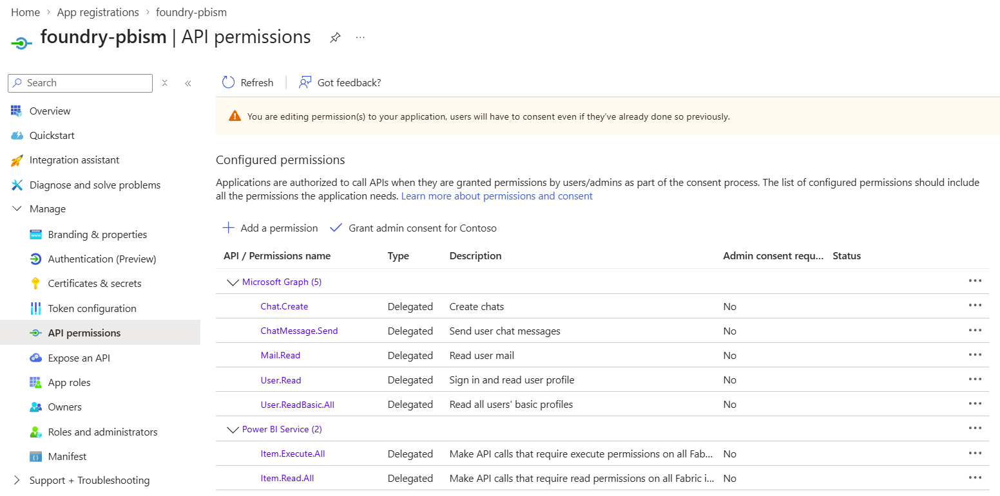
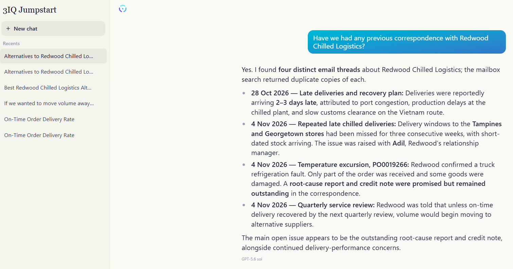
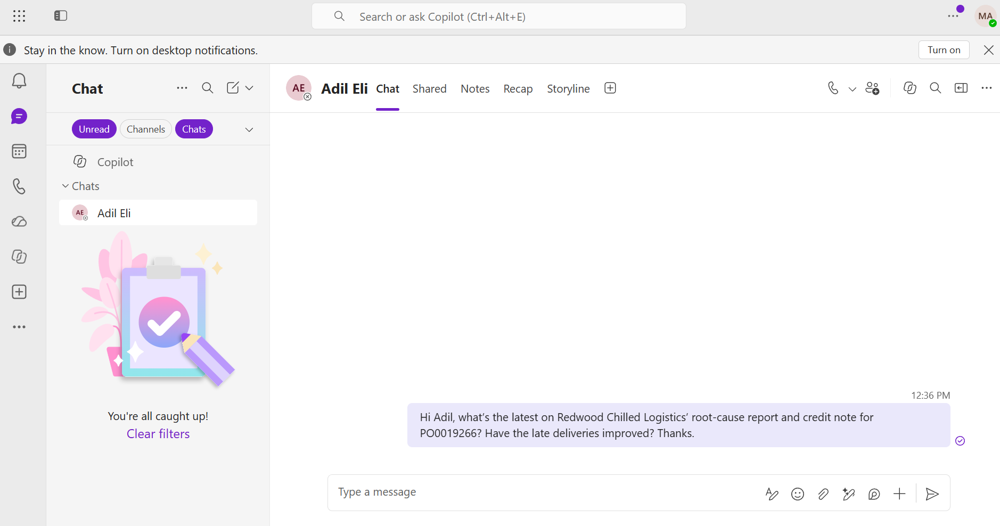

# Lab 05 - Work Context: Email and Teams (Optional)

**Time to complete:** 45 minutes

## Objective

Give the agent a little workplace context and one workplace action, for the signed-in user only. You add the code to the app yourself:

1. **Read email** to find out whether there is any earlier correspondence with **Redwood Chilled Logistics**, the worst-performing supplier in the `3IQ_SM` report.
2. **Send a Teams message** to the relationship manager for Redwood Chilled Logistics, asking for the latest status of the issue, but only after you approve the exact text.

## Why not the Work IQ MCP server?

The Work IQ MCP servers are still in preview, and using them needs a **tenant admin** to grant consent (plus a Microsoft 365 Copilot license). This lab shows the same pattern with a small MCP server of our own on top of Microsoft Graph:

| Tool | Microsoft Graph call | Delegated permission | Admin consent by default |
|---|---|---|---|
| `search_emails` | `GET /me/messages?$search=` | `Mail.Read` | No |
| `find_person` | `GET /users?$filter=startswith(...)` | `User.ReadBasic.All` | No |
| `send_teams_message` | `POST /chats` (finds or creates the 1:1 chat), then `POST /chats/{id}/messages` | `Chat.Create`, `ChatMessage.Send` | No |

`Chat.Create` and `ChatMessage.Send` are the least-privileged permissions for sending into a 1:1 chat.



How it works:

- The app asks for the Graph permissions at **sign-in**, next to the Power BI ones. Each user consents for themselves.
- For every chat request the app sends the user's Graph token to the work MCP server as a bearer token. The server stores no credentials and the token never reaches the browser, so every call runs as that user, with no more access than that user has.
- `send_teams_message` is a two-step tool. With `confirmed=false` it only returns a preview of the recipient and text. It sends only when called again with `confirmed=true`, and the skill allows that only after you approve in your next message.
- The tool call, including the message text, is saved in the Cosmos DB tool log from Lab 04, which gives you an audit trail.

The feature is off unless `WORK_MCP_ENDPOINT` is set, so the app behaves exactly as in Labs 01 to 04 until you turn it on.

## Pre-requisites

- [Lab 03](../Lab03-Run-Locally-and-Test/Lab03-Run-Locally-and-Test.md) completed: the app runs on your localhost.
- Your signed-in user has an **Exchange Online mailbox** and a **Teams license**.
- A second user in the tenant (for example `adil@<your-tenant>`) with a **Teams license**. In a demo tenant, create one in the [Microsoft 365 admin center](https://admin.microsoft.com) under **Users > Active users > Add a user**. Any colleague works if you replace "Adil" in the skill.

All paths below are relative to `0 to 3IQs/3iq-jumpstart` (the **app**) and `0 to 3IQs/LEVEL-UP/LabFiles/Lab05` (the **lab files**).

## Section 1: Add Microsoft Graph delegated permissions

1. In the [Azure portal](https://portal.azure.com), open **App registrations** and select the same service principal you have been using.

2. Select **API permissions > Add a permission > Microsoft Graph > Delegated permissions**. Add `Mail.Read`, `User.ReadBasic.All`, `Chat.Create` and `ChatMessage.Send`.

3. These four permissions don't require admin consent by default, so each user can consent for themselves at sign-in. If your tenant restricts user consent, users will see "Need admin approval" and an admin needs to select **Grant admin consent** once.
   

## Section 2: Prepare the email data

1. Open Outlook for the user you sign in with, and send yourself the three emails in [`seed-emails.md`](../LabFiles/Lab05/seed-emails.md).

2. Wait a few minutes. Mail search is indexed, so brand-new emails may not show up immediately.

## Section 3: Add and run the work MCP server

The work MCP server is two files that run as their own small process next to the app.

1. Open a new terminal in VS Code at the repository root and copy the server into the app:

   ```powershell
   Copy-Item ".\0 to 3IQs\LEVEL-UP\LabFiles\Lab05\workMcp" ".\0 to 3IQs\3iq-jumpstart\server\src\workMcp" -Recurse
   ```

2. Open the two files and read them before you run them:
   - `server/src/workMcp/graph.ts` calls Microsoft Graph, one function per call in the table above.
   - `server/src/workMcp/index.ts` defines the three tools and the HTTP endpoint `/mcp`. Find `send_teams_message` and the `confirmed` check.

3. Start it:

   ```powershell
   cd ".\0 to 3IQs\3iq-jumpstart\server"
   npx tsx watch src/workMcp/index.ts
   ```

   The terminal prints `[work-mcp] listening on http://127.0.0.1:3001/mcp`. It only listens on your own machine. Leave this terminal running.

4. In a new terminal window, check that it responds:

   ```powershell
   Invoke-RestMethod http://127.0.0.1:3001/health
   ```

   The result is `status : ok`.

## Section 4: Connect the app to the work MCP server

You will make five small changes. Open each file in VS Code, find the **Find** block, and replace it with the **Replace with** block.

### 4.1 Add the session helper

Copy [`workSession.ts`](../LabFiles/Lab05/workSession.ts) next to the Fabric client:

```powershell
Copy-Item ".\0 to 3IQs\LEVEL-UP\LabFiles\Lab05\workSession.ts" ".\0 to 3IQs\3iq-jumpstart\server\src\mcp\workSession.ts"
```

It does two things: `openWorkSession` connects to the work MCP server, and `mergeSessions` presents the Fabric IQ tools and the work tools to the chat loop as one list, sending each tool call to the server that owns it.

### 4.2 Let the MCP client connect to any endpoint

The Fabric IQ client has its endpoint hard-wired. In `server/src/mcp/fabricClient.ts`:

**Find**

```ts
export async function openFabricSession(getToken: () => Promise<string>): Promise<FabricSession> {
  const endpoint = process.env.FABRIC_MCP_ENDPOINT || DEFAULT_ENDPOINT
  const variant = process.env.FABRIC_MCP_VARIANT || DEFAULT_VARIANT
```

**Replace with**

```ts
export function openFabricSession(getToken: () => Promise<string>): Promise<FabricSession> {
  return openMcpSession({
    endpoint: process.env.FABRIC_MCP_ENDPOINT || DEFAULT_ENDPOINT,
    variant: process.env.FABRIC_MCP_VARIANT || DEFAULT_VARIANT,
    getToken,
  })
}

export interface McpSessionOptions {
  endpoint: string
  getToken: () => Promise<string>
  variant?: string
}

/** Opens a streamable-HTTP MCP connection that sends the user's token on every request. */
export async function openMcpSession({ endpoint, variant, getToken }: McpSessionOptions): Promise<FabricSession> {
```

Fabric IQ behaves exactly as before; the body of the function is unchanged.

### 4.3 Ask for the Graph permissions at sign-in

In `server/src/auth/entra.ts`, make three changes.

**(a)** Add the scopes and the on/off switch. **Find**

```ts
export class AuthRequiredError extends Error {
```

**Replace with**

```ts
// Lab 05: delegated Microsoft Graph permissions that users can consent to themselves.
export const WORK_SCOPES = [
  'https://graph.microsoft.com/Mail.Read',
  'https://graph.microsoft.com/User.ReadBasic.All',
  'https://graph.microsoft.com/Chat.Create',
  'https://graph.microsoft.com/ChatMessage.Send',
]

/** The work tools are opt-in: set WORK_MCP_ENDPOINT to turn them on. */
export function isWorkEnabled(): boolean {
  return Boolean(process.env.WORK_MCP_ENDPOINT)
}

export class AuthRequiredError extends Error {
```

**(b)** Include them in the sign-in request. In `createLoginRequest`, **Find**

```ts
    scopes: FABRIC_SCOPES,
    redirectUri: getRedirectUri(),
    codeChallenge: challenge,
```

**Replace with**

```ts
    // Consent covers Power BI and Graph; the code is redeemed for Power BI, Graph tokens come from the refresh token.
    scopes: isWorkEnabled() ? [...FABRIC_SCOPES, ...WORK_SCOPES] : FABRIC_SCOPES,
    redirectUri: getRedirectUri(),
    codeChallenge: challenge,
```

Only this one occurrence should match. Leave the `scopes: FABRIC_SCOPES` in `completeLogin` and `getFabricToken` alone: those redeem and refresh the Power BI token.

**(c)** Add a function that returns a Graph token. **Find**

```ts
export async function signOut(
```

**Replace with**

```ts
/** Returns a fresh delegated Microsoft Graph access token for the work tools. */
export async function getWorkToken(homeAccountId: string): Promise<string> {
  const app = getApp()
  const account = await app.getTokenCache().getAccountByHomeId(homeAccountId)
  if (!account) throw new AuthRequiredError()
  try {
    const result = await app.acquireTokenSilent({ account, scopes: WORK_SCOPES })
    return result.accessToken
  } catch {
    // Also happens when the user signed in before the work scopes were enabled.
    throw new AuthRequiredError()
  }
}

export async function signOut(
```

### 4.4 Give the chat route the work tools

In `server/src/routes/chat.ts`, make four changes.

**(a)** Imports. **Find**

```ts
import { AuthRequiredError, getFabricToken, isAuthEnabled } from '../auth/entra.js'
import { openFabricSession, type FabricSession } from '../mcp/fabricClient.js'
```

**Replace with**

```ts
import { AuthRequiredError, getFabricToken, getWorkToken, isAuthEnabled, isWorkEnabled } from '../auth/entra.js'
import { openFabricSession, type FabricSession } from '../mcp/fabricClient.js'
import { mergeSessions, openWorkSession } from '../mcp/workSession.js'
```

**(b)** Status text shown while a tool runs. In `TOOL_STATUS`, **Find**

```ts
  ExecuteQuery: 'Running query on semantic model...',
}
```

**Replace with**

```ts
  ExecuteQuery: 'Running query on semantic model...',
  search_emails: 'Searching your email...',
  find_person: 'Looking up a colleague...',
  send_teams_message: 'Preparing Teams message...',
}
```

**(c)** Decide whether the work tools are allowed, and make sure the user has consented. **Find**

```ts
      const fabricAllowed = !isToolSkill || skill.allowedClients.includes('fabric-mcp')
```

**Replace with**

```ts
      const fabricAllowed = !isToolSkill || skill.allowedClients.includes('fabric-mcp')
      const workAllowed = isWorkEnabled() && (!isToolSkill || skill.allowedClients.includes('work-mcp'))
```

Then **Find**

```ts
          await getFabricToken(homeAccountId)
```

**Replace with**

```ts
          await getFabricToken(homeAccountId)
          if (workAllowed) await getWorkToken(homeAccountId)
```

If the user has not consented to Graph yet, this makes the app ask them to sign in again.

**(d)** Connect to the work MCP server after Fabric IQ. **Find**

```ts
        }
        if (isToolSkill) {
```

**Replace with**

```ts
        }
        if (authEnabled && workAllowed) {
          send({ type: 'status', label: 'Connecting to work tools...' })
          try {
            const work = await timed(request.log, 'work.connect', {}, () =>
              openWorkSession(() => getWorkToken(homeAccountId!))
            )
            fabric = mergeSessions(fabric, work)
          } catch (err) {
            request.log.error(err, 'Work MCP connection failed')
            send({ type: 'error', message: 'Could not connect to the work MCP server' })
            return
          }
        }
        if (isToolSkill) {
```

Nothing else in the chat loop changes: it already sends every tool in `fabric.tools` to the model and every tool call to `fabric.callTool`.

### 4.5 Turn it on

Add this line to `.env` in `3iq-jumpstart`:

```
WORK_MCP_ENDPOINT=http://localhost:3001/mcp
```

Check that everything compiles. In a new terminal:

```powershell
cd ".\0 to 3IQs\3iq-jumpstart\server"
npx tsc --noEmit
```

It prints nothing when there are no errors. If it reports one, re-check the **Find / Replace with** block named in the file and line it points to.

## Section 5: Add the skill and the policy

The skill tells the agent *how* to use the work tools. The global policy in `AGENTS.md` decides *whether* it may write at all. Both must allow it.

1. Open `server/skills/default.md`, go to the end of the file and paste the contents of [`work-skill.md`](../LabFiles/Lab05/work-skill.md). Save the file.

2. Open `server/agents/AGENTS.md`. Under **Not permitted**, replace

   ```
   - Execute write or delete operations on data
   ```

   with

   ```
   - Execute write or delete operations on data, except sending a Teams message with the send_teams_message tool after the user has explicitly approved the recipient and the text
   ```

3. Restart the app server (`Ctrl+C`, then `npm run dev:server` from `3iq-jumpstart`) so it picks up `.env` and `AGENTS.md`. `npm run dev:client` and the work MCP server can keep running.

## Section 6: Test it

1. Open http://localhost:5173. Select **Sign out** and then **Sign in with Microsoft** again. The consent screen now also lists reading your mail and sending chat messages. Select **Accept**.

2. Ask:

   ```
   Have we had any previous correspondence with Redwood Chilled Logistics?
   ```

   The agent calls `search_emails` and summarises your three emails: late deliveries, the temperature excursion on `PO0019266`, and the service review warning. It should not mention anything that is not in the emails.
   

3. Ask:

   ```
   Ask Adil, the relationship manager for Redwood Chilled Logistics, for the latest status on the issue.
   ```

   The agent calls `find_person`, drafts a message, and shows you the recipient and exact text with **Send this?**. **Nothing has been sent yet.**

4. **Human-in-the-loop check:** reply `Make it shorter and more direct.` The agent redrafts and asks again. Then reply `Yes, send it.`

5. The agent confirms the message was sent. Open your **Teams Chat**, and find the message from you.
   

6. Open the `daxlog` container in Cosmos DB (Lab 04). You should see the `send_teams_message` calls: one with `confirmed: false`, then one with `confirmed: true`.

## Undo

To go back to the app as it was after Lab 04, remove `WORK_MCP_ENDPOINT` from `.env`, then run `git restore server/src server/skills server/agents` from `3iq-jumpstart` and delete `server/src/workMcp` and `server/src/mcp/workSession.ts`. (`git restore` also reverts any other uncommitted changes in those folders.)

## Key takeaways

- You can get useful workplace context and actions without tenant-admin consent or a preview service, by using delegated Microsoft Graph permissions that users consent to themselves.
- A small MCP server that forwards the user's own token keeps access scoped to that user.
- Write actions need layers: a global policy (`AGENTS.md`), a skill with a workflow, a two-step tool (`confirmed`), and an audit log.

---

**Previous:** [Lab 04: Deployment and Observability](../Lab04-Deployment-and-Observability/Lab04-Deployment-and-Observability.md)

