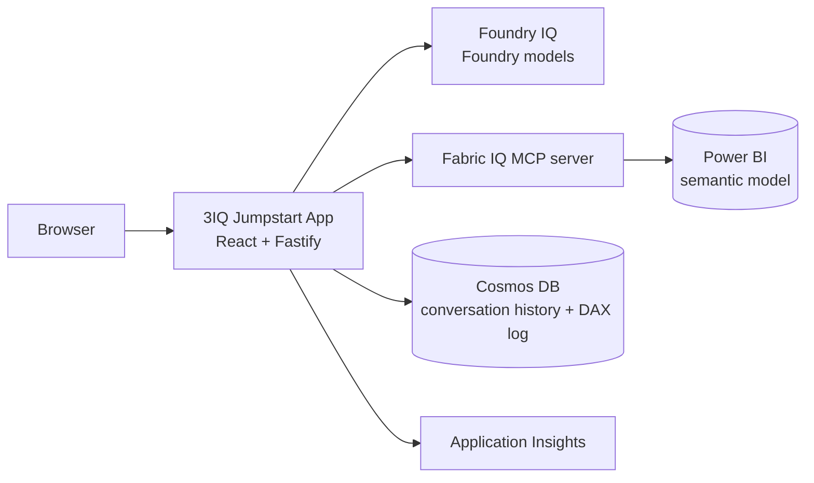

# 3IQ Jumpstart Accelerator

## Contents

- [Architecture](#architecture)
- [Quickstart](#quickstart)
- [Jumpstart Architecture Components](#jumpstart-architecture-components)
- [Deployment to Azure Container Apps](#deployment-to-azure-container-apps)
- [Work IQ (Optional)](#work-iq-optional)

A jumpstart for building an AI agent that answers business questions from your Power BI semantic models. It combines three layers: **Foundry IQ** (models), **Fabric IQ** (enterprise data context), and **Work IQ** (workplace context and actions, optional). 

The included 3IQ Jumpstart App is a streaming chat UI (React + Fastify) that signs users in with Microsoft Entra, so every answer respects the user's own Fabric permissions.

## Architecture

The app calls Foundry models for reasoning and the Fabric IQ MCP server to read and query Power BI semantic models as the signed-in user.



## Quickstart

Run the app locally. You need Node.js 22 or later (24 LTS recommended), the Azure CLI, a Foundry resource with a deployed model, and an Entra app registration with delegated Power BI permissions (`Item.Read.All`, `Item.Execute.All`). Step-by-step setup is in the [LEVEL-UP Setup Guide](LEVEL-UP/00-Setup-Guide.md).

```powershell
cd ".\0 to 3IQs\3iq-jumpstart"
npm install
Copy-Item .env.example .env
```

Open `.env` and replace each `<placeholder>` with your own environment values:

```env
# Microsoft Foundry
AZURE_OPENAI_ENDPOINT=https://<foundry-resource>.openai.azure.com/openai/v1
MODEL_DEPLOYMENT_NAME=<default-model-deployment>
MODEL_DEPLOYMENTS=<deployment-name>:<display-label>,<deployment-name>:<display-label>

# App Service Principal
SPN_TENANT_ID=<tenant-id>
SPN_CLIENT_ID=<client-id>
SPN_CLIENT_SECRET=<client-secret>

# Public URL users browse to. Redirect URI registered in Service Principal = APP_BASE_URL + /auth/callback
APP_BASE_URL=http://localhost:5173

# Chat history and DAX log (Azure Cosmos DB for NoSQL)
COSMOS_ENDPOINT=https://<cosmosdb-account>.documents.azure.com:443/
COSMOS_DATABASE=<cosmosdb-database>

# Fabric IQ MCP Server
# FABRIC_MCP_ENDPOINT=https://fabriciq.svc.cloud.microsoft/v1/mcp/fabriciq

# App Insights - Observability
APPLICATIONINSIGHTS_CONNECTION_STRING=<connection-string>

# Server
PORT=8080
NODE_ENV=development
```

Register `http://localhost:5173/auth/callback` as a redirect URI on the app registration. Then sign in to Azure and start the backend and frontend in two terminals:

```powershell
az login
npm run dev:server            # terminal 1: backend on :8080
npm run dev:client            # terminal 2: frontend on :5173
```
Open [http://localhost:5173](http://localhost:5173) and sign in with Microsoft. 

## Jumpstart Architecture Components

The 3IQ jumpstart app separates into two modular layers:

- **Frontend**: A React + TypeScript single-page application (SPA) that delivers the chat interface, streaming output, and user experience. It can be modified without touching the backend.
- **Backend**: The Fastify server that calls Foundry models through the Responses API, applies the skill and `AGENTS.md` guardrails, and connects to the Fabric IQ MCP server. New tools and data sources are plugged in here without changes to the UI.

The codebase is a **TypeScript monorepo** using npm workspaces. The frontend, backend, and shared types are maintained in a single repository.

```
3iq-jumpstart/
├── client/                    # Vite + React + TypeScript + Tailwind CSS
│   ├── src/
│   │   ├── components/        # React UI components
│   │   ├── hooks/             # Custom React hooks (useChat)
│   │   ├── App.tsx            # Chat UI
│   │   └── main.tsx           # App entry point
│   ├── index.html
│   ├── vite.config.ts
│   └── tailwind.config.js
├── server/                    # Node.js + Fastify + TypeScript
│   ├── src/
│   │   ├── routes/            # Fastify route handlers (chat, conversations, models, auth, skills, health)
│   │   ├── agent/             # Responses API client, model catalog, conversation titles
│   │   ├── auth/              # Entra ID sign-in
│   │   ├── mcp/               # Fabric IQ MCP client and source links
│   │   ├── store/             # Cosmos DB conversation history and DAX log
│   │   ├── observability/     # OpenTelemetry tracing and timing
│   │   ├── skills/            # Skill file loader
│   │   └── index.ts           # Fastify server entry point
│   ├── skills/                # Skill files (.md)
│   └── agents/                # AGENTS.md global guardrails
├── shared/                    # Shared TypeScript types (no runtime deps)
│   └── src/index.ts           # SSE events and chat/conversation types
├── .env.example               # Environment variable template
├── package.json               # npm workspaces root
```

Both `client/` and `server/` import from `shared/` for end-to-end type safety across the SSE boundary.

Each component in the [architecture diagram](#architecture) is summarised below.

### Frontend

- Vite + React + TypeScript + Tailwind CSS app in `client/`.
- Sends `POST /api/chat` and reads the response as a stream, so answers appear word by word with live status indicators such as *"Connecting to Fabric IQ..."*, *"Reading semantic model schema..."* and *"Running query on semantic model..."*.
- Users sign in with Microsoft Entra ID. Tokens stay on the server, and the browser only holds a signed session cookie.

### Backend

- Fastify + TypeScript in `server/`, with Zod-validated routes for chat, conversations, models and sign-in.
- Swagger UI at `/docs` ([http://localhost:8080/docs](http://localhost:8080/docs) when running locally) lets you try every endpoint. It is generated from the Zod route schemas, so it always matches the code.
- Skills in `server/skills/` and the global guardrails in `server/agents/AGENTS.md` shape every answer.

### Foundry IQ (models)

- The backend calls the Responses API on the Foundry resource's Azure OpenAI v1 endpoint. There is no pre-created agent: each request sends the model, the instructions and the Fabric IQ tool definitions, and the backend runs the tool-call loop until the model answers.
- The instructions come from files you control: the global guardrails in `AGENTS.md` plus the skill file, `server/skills/default.md`.
- Users pick from an approved list of model deployments (`GET /api/models`).

### Fabric IQ MCP server

- A read-only MCP server. The agent finds the report or semantic model, reads its schema, writes the DAX, and explains the result.
- Tools: `DiscoverArtifacts`, `ResolveFabricItem`, `GetReportMetadata`, `GetSemanticModelSchema`, `ValueSearch` and `ExecuteQuery`.
- Accepts only delegated Entra tokens, so results respect each user's permissions, including row-level security.
- Details: [Get started with the Fabric IQ MCP server](https://learn.microsoft.com/en-us/fabric/iq/connectors/fabric-iq-mcp) (Microsoft Learn).

### Cosmos DB

- Serverless Azure Cosmos DB for NoSQL stores conversation history and an audit log of every DAX query. 
- Accessed with Entra ID through `DefaultAzureCredential` and the built-in *Cosmos DB Built-in Data Contributor* role, so there are no account keys.

| Container | Partition key | Contents |
|---|---|---|
| `conversations` | `/userId` | title, last response id (chains the model's context), model, timestamps |
| `messages` | `/conversationId` | user and assistant messages, the answering model's label, and the DAX each answer ran |
| `daxlog` | `/userId` | one item per Fabric IQ tool call: tool, DAX text, arguments, success, duration, user, conversation, model |

- Result rows are not stored, only the DAX and call metadata, because row-level security makes result data user-specific.

### Application Insights

- Telemetry is set up in `server/src/observability/tracer.ts`, which `server/src/instrument.ts` loads first so it runs before Fastify and HTTP are imported. It turns on only when `APPLICATIONINSIGHTS_CONNECTION_STRING` is set, so local runs work without it.
- One `useAzureMonitor()` call traces every outgoing HTTP call (including each model call to the Azure OpenAI endpoint) and Azure SDK operations by name, and `FastifyInstrumentation` adds the incoming routes. Each model round and Fabric IQ tool call also gets its own span, so you can see how long each one took.

```typescript
useAzureMonitor({
  azureMonitorExporterOptions: {
    connectionString: process.env.APPLICATIONINSIGHTS_CONNECTION_STRING,
  },
})

registerInstrumentations({
  instrumentations: [new FastifyInstrumentation()],
})
```

- View traces in **Application Insights**: a full trace tree for every request, KQL queries by route, error type or duration, and alerts on error rates or latency.

## Deployment to Azure Container Apps

- The image is built in Azure Container Registry with `az acr build`, so Docker is not needed on your machine. The Container App is created first with a quickstart image, then switched to your image once its identity has access.
- The Container App runs with a system-assigned managed identity, so there are no Azure keys. The identity gets **AcrPull** on the registry, **Key Vault Secrets User** on the Key Vault, **Foundry User** on the Foundry resource and **Cosmos DB Built-in Data Contributor** on the Cosmos DB account.
- `SPN_TENANT_ID`, `SPN_CLIENT_ID`, `SPN_CLIENT_SECRET` and `APPLICATIONINSIGHTS_CONNECTION_STRING` are stored in Azure Key Vault and referenced from Container App secrets.
- Ingress is external HTTPS on target port `8080`. Run a single replica: sessions and the token cache are in memory, so use a shared session and token store before scaling out.
- Add `https://<container-app-url>/auth/callback` as a redirect URI on the Entra app registration.
- Step-by-step instructions: [Lab 04: Deployment and Observability](LEVEL-UP/Lab04-Deployment-and-Observability/Lab04-Deployment-and-Observability.md).

---

## Work IQ (Optional)

> Work IQ is optional and separate from the 3IQ Jumpstart App. Follow this guide only if you want to add workplace context and actions.
>
> If you cannot get tenant admin consent, or the Work IQ MCP preview is unreliable for you, [Lab 05](LEVEL-UP/Lab05-Work-IQ-Optional/Lab05-Work-IQ-Optional.md) walks you through adding a lighter option to the app yourself: email search and Teams messages through Microsoft Graph with user-consented permissions.

### What is Work IQ?

Work IQ is the Microsoft IQ layer for **how work gets done**. It gives AI agents context from Microsoft 365 Copilot data: emails, meetings, documents, Teams messages, and people and their relationships. Agents ask questions in natural language, for example *"What did my manager say about the project deadline?"*, instead of calling a separate Microsoft Graph API for each workload.

### Work IQ MCP at a glance

| | |
|---|---|
| What it is | The Work IQ CLI and MCP server (`@microsoft/workiq`). AI assistants and agents query Microsoft 365 data in natural language |
| Typical data | Emails, meetings, documents, Teams messages, people and business application data |
| How you run it | `npx -y @microsoft/workiq mcp` starts the MCP server (stdio). You can also add it to VS Code or GitHub Copilot CLI |
| Prerequisites | Node.js, a usage-based billing plan (Copilot Credits) with an Azure subscription and resource group, the user assigned to that plan, **tenant admin consent** for the Work IQ application in Microsoft Entra, and the EULA accepted with `workiq accept-eula` |
| Status | Work IQ reached general availability on June 16, 2026. Microsoft's earlier per-app MCP servers (Mail, Calendar, Teams, SharePoint) are listed as preview. Check Microsoft Learn for the current status |

Details: [Microsoft Work IQ CLI and MCP server](https://learn.microsoft.com/en-us/microsoft-365/copilot/extensibility/work-iq/cli) (Microsoft Learn) and the [Work IQ GitHub repo](https://github.com/microsoft/work-iq-mcp).

### Why Lab 05 uses Microsoft Graph instead

- Work IQ MCP needs a **tenant admin** to grant consent and a usage-based billing plan to be set up first. That is rarely possible for every participant in a lab or demo tenant.
- Lab 05 shows the same pattern, where an agent gets workplace context and takes one action as the signed-in user, with a small MCP server on Microsoft Graph and permissions that users consent to themselves.
- It is a pattern demo, not a replacement for Work IQ. Moving to the Work IQ MCP once permissions are simpler is on the roadmap.

