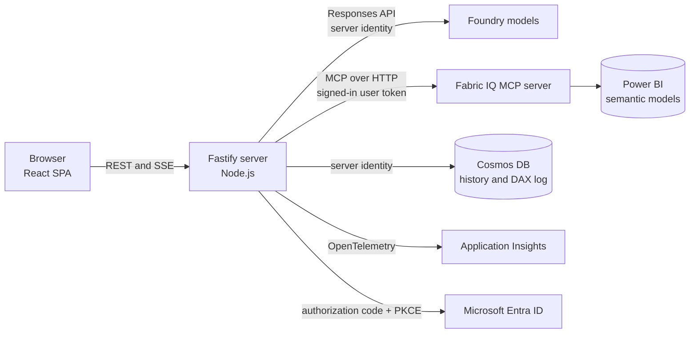
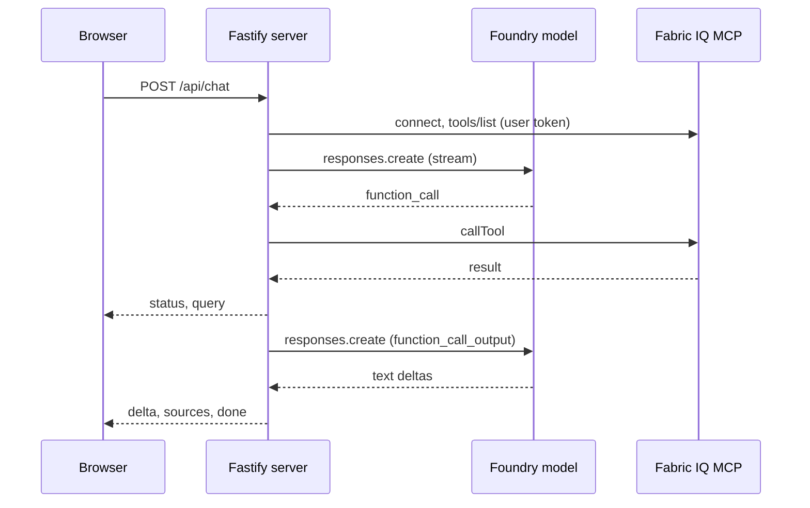

# Technical Specification — 3IQ Jumpstart Framework

## 1. Purpose and scope

The 3IQ Jumpstart is a streaming chat web app that answers business questions from Power BI reports and semantic models in Microsoft Fabric. A Foundry model reasons about the question, and the **Fabric IQ MCP server** lets it find the right item, read its schema, write DAX, and run it. Everything that touches Fabric data runs as the **signed-in user**, so row-level security and every other Power BI permission still apply.

**Goals**

- A modular React frontend and Fastify backend that can be changed independently.
- No pre-created agent and no API keys: the backend sends the model, the instructions and the tool definitions on every request and authenticates with Entra ID.
- Per-user conversation history and an audit log of every DAX query.
- Observability for every model round and tool call.

**Out of scope (not implemented)**

- Write or delete operations on data. Fabric IQ MCP is read-only.
- Fabric ontologies and Fabric data agents. Fabric IQ MCP covers Power BI reports and semantic models only.
- Work IQ. The app does not integrate it; the standalone Work IQ MCP guide in the project README is separate.
- Running more than one server replica (sessions and tokens are in memory, see section 9).
- An automated test suite. There are no tests in the repository.

### 1.1 User flow

1. The user opens the app. If Entra sign-in is configured and the user is not signed in, a **Sign in with Microsoft** page is shown.
2. The user picks a model (if more than one is approved) and asks a question in plain language.
3. The answer streams in as it is generated. Status chips show what the agent is doing, such as *Connecting to Fabric IQ...* or *Running query on semantic model...*.
4. Under the answer, the app shows the **Sources** (Power BI items the answer was based on, as links) and the **Queries run** (the DAX, collapsed).
5. With history enabled, the conversation appears in the **Recents** sidebar and can be reopened or deleted. Follow-up questions continue the same model conversation.

### 1.2 Capabilities

| Capability | Behavior |
|---|---|
| Streaming chat | Server-Sent Events over `POST /api/chat`; text, status, queries, sources and completion are separate event types |
| Microsoft sign-in | Entra authorization-code flow with PKCE; the browser only holds a session cookie |
| Model picker | Users choose from an administrator-defined list of Foundry deployments |
| Fabric IQ tools | Tool definitions are read from the MCP server at request time and handed to the model as function tools |
| Skills and guardrails | `server/agents/AGENTS.md` (global policy) plus a skill file (`server/skills/*.md`) form the instructions |
| Sources | Power BI items used by an answer are shown as links that open them in Power BI |
| Queries run | The DAX behind each answer is shown and stored |
| Conversation history | Cosmos DB, scoped to the signed-in user; list, reopen, delete |
| DAX audit log | One record per Fabric IQ tool call, kept after a conversation is deleted |
| Stop | The user can cancel a running answer; the server cancels the model call |
| Observability | OpenTelemetry to Application Insights, with a span per model round and tool call |
| API docs | Swagger UI at `/docs`, generated from the Zod route schemas |

## 2. Architecture



### 2.1 Two identities

| Identity | Used for | How it is obtained |
|---|---|---|
| **Server identity** | Calling Foundry models and Cosmos DB | `DefaultAzureCredential`: your `az login` session locally, the Container App's managed identity in Azure |
| **User identity** | Calling Fabric IQ MCP | Delegated Entra token for the signed-in user, held in the server's MSAL token cache |

### 2.2 Design principles

1. **Modular layers.** The frontend is a static SPA; the backend exposes a small HTTP API. Either can change without the other as long as the API and `shared/` types hold.
2. **Everything per request.** No agent object is created in Foundry. Each request sends the model, instructions and tools, and state is chained with `previous_response_id`.
3. **Runtime discovery.** MCP tool definitions are read with `tools/list` on every session; schemas are never hard-coded.
4. **User-delegated data access.** Fabric data is only ever read with the user's own token.
5. **The server owns conversation state.** With history on, a client cannot continue another user's conversation.
6. **Degrade, don't fail.** A Cosmos DB problem never blocks chat.

## 3. Repository structure

The codebase is a **TypeScript monorepo** using npm workspaces (`shared`, `client`, `server`). The server and client import types from `shared/` with `import type`, so `shared` has no runtime role. Build `shared` first when building the client or server, because they resolve its types from `shared/dist`.

```
3iq-jumpstart/
├── client/                    # Vite + React + TypeScript + Tailwind CSS
│   ├── src/
│   │   ├── components/
│   │   │   └── MarkdownContent.tsx   # Markdown renderer with copyable code blocks
│   │   ├── hooks/
│   │   │   └── useChat.ts            # All chat, auth, model, history and SSE state
│   │   ├── App.tsx                   # Chat UI, sidebar, model picker, sources, queries
│   │   ├── index.css
│   │   └── main.tsx                  # App entry point
│   ├── index.html
│   ├── vite.config.ts                # Dev proxy for /api and /auth
│   ├── tailwind.config.js
│   └── postcss.config.js
├── server/                    # Node.js + Fastify + TypeScript
│   ├── src/
│   │   ├── index.ts                  # Server entry point and plugin wiring
│   │   ├── instrument.ts             # Loads .env, then starts telemetry (must run first)
│   │   ├── routes/                   # auth, chat, conversations, health, models, skills
│   │   ├── agent/
│   │   │   ├── client.ts             # OpenAI client for the Responses API; AGENTS.md loader
│   │   │   ├── models.ts             # Approved model catalog
│   │   │   └── title.ts              # Conversation title generation
│   │   ├── auth/entra.ts             # MSAL confidential client, PKCE, token refresh
│   │   ├── mcp/
│   │   │   ├── fabricClient.ts       # Fabric IQ MCP session: tools, calls, retries
│   │   │   └── sources.ts            # Tracks the Power BI items an answer used
│   │   ├── store/cosmos.ts           # Conversation history and DAX log
│   │   ├── skills/loader.ts          # Skill file parser and loader
│   │   └── observability/            # tracer.ts (Azure Monitor), timing.ts (spans and timings)
│   ├── agents/AGENTS.md              # Global agent policies
│   └── skills/default.md             # Default skill
├── shared/
│   └── src/index.ts                  # SSE events and API types shared by client and server
├── .env.example                      # Environment variable template
├── package.json                      # npm workspaces root and scripts
└── Dockerfile
```

## 4. Configuration

For local development, put these in `.env` at the monorepo root (`3iq-jumpstart/.env`, git-ignored). `instrument.ts` loads it before anything else. In Azure, set them as Container App environment variables. `SPN_TENANT_ID`, `SPN_CLIENT_ID`, `SPN_CLIENT_SECRET` and `APPLICATIONINSIGHTS_CONNECTION_STRING` are stored in Azure Key Vault and referenced from Container App secrets (see section 13.3).

| Variable | Required | Description |
|---|---|---|
| `AZURE_OPENAI_ENDPOINT` | Yes | Foundry resource's Azure OpenAI v1 endpoint, `https://<resource>.openai.azure.com/openai/v1`. The server refuses to start without it |
| `MODEL_DEPLOYMENT_NAME` | Yes | Default model deployment name. Must match the deployment exactly, case included. It is always part of the approved catalog. The code does not check it at startup, so a missing value fails at the first chat |
| `MODEL_DEPLOYMENTS` | No | Approved model catalog, `deployment[:Label]` comma-separated. The label is what the model picker shows |
| `SPN_TENANT_ID`, `SPN_CLIENT_ID`, `SPN_CLIENT_SECRET` | For sign-in | Entra app registration used for user sign-in. If any is missing, sign-in and Fabric IQ are disabled |
| `APP_BASE_URL` | For sign-in | URL users browse to; the redirect URI is `APP_BASE_URL/auth/callback`. Defaults to `http://localhost:<PORT>`. Use `http://localhost:5173` for local development |
| `COSMOS_ENDPOINT` | No | Cosmos DB for NoSQL account endpoint. Enables history and the DAX log (sign-in must also be enabled) |
| `COSMOS_DATABASE` | No | Database name; default `threeiq` |
| `FABRIC_MCP_ENDPOINT` | No | Overrides the Fabric IQ MCP endpoint. Default `https://fabriciq.svc.cloud.microsoft/v1/mcp/fabriciq`; use `https://api.fabric.microsoft.com/v1/mcp/fabriciq` with private links |
| `FABRIC_MCP_VARIANT` | No | Overrides the `X-Variants` header. Default `Fabric.Routing.FabricIQ.V1` |
| `MAX_TOOL_ROUNDS` | No | Maximum number of model rounds that call tools for one question; default `12`, minimum `1` |
| `APPLICATIONINSIGHTS_CONNECTION_STRING` | No | Turns on Azure Monitor telemetry when set |
| `PORT` | No | Server port; default `8080` |
| `NODE_ENV` | No | `production` makes the server serve the built SPA and mark the session cookie `secure` |

### 4.1 Feature switches

| Feature | On when | When off |
|---|---|---|
| Sign-in and Fabric IQ | `SPN_TENANT_ID`, `SPN_CLIENT_ID` and `SPN_CLIENT_SECRET` are all set | The server logs a warning. `/api/auth/me` returns `enabled: false`; chat works but the model has no Fabric tools |
| History and DAX log | `COSMOS_ENDPOINT` is set **and** sign-in is enabled **and** the user is signed in | `/api/conversations` returns `{ enabled: false, items: [] }`; the sidebar is hidden and the client sends `previousResponseId` instead |
| Telemetry | `APPLICATIONINSIGHTS_CONNECTION_STRING` is set | No telemetry; spans become no-ops |

## 5. Frontend

### 5.1 Stack

| Technology | Role |
|---|---|
| Vite 5 | Dev server (port 5173) and production build into `client/dist/` |
| React 18 + TypeScript | UI |
| Tailwind CSS 3 | Styling; dark mode through the `class` strategy |
| `react-markdown` + `remark-gfm` | Renders answers, including tables and code blocks |

### 5.2 Structure

| Unit | Responsibility |
|---|---|
| `useChat` (`hooks/useChat.ts`) | Owns all state and API calls: messages, streaming, activity label, model catalog and selection, auth status, history list, active conversation, stop |
| `App` (`App.tsx`) | Layout and views: sign-in gate, hero view (greeting and input), chat view |
| `Sidebar` | Conversation list with new and delete; resizable on desktop (200 to 520 px, default 256, stored in `localStorage`), a slide-in drawer on small screens |
| `ModelPicker` | Dropdown of approved models; a plain label when only one exists; disabled while streaming |
| `SourcesRow`, `QueriesPanel` | The Sources links (only `https` URLs) and the collapsible DAX list |
| `InputBox` | Auto-growing textarea, Enter to send, Shift+Enter for a new line, a Stop button while streaming |
| `MarkdownContent` | Markdown rendering with a copy button on code blocks |

The sidebar is shown only when history is enabled and the user is signed in. Without history, a **New chat** button appears in the header. The selected model is stored in `localStorage` under `model`, the theme under `theme`.

### 5.3 Consuming the stream

`useChat` sends `POST /api/chat` with `{ message, model, conversationId, previousResponseId }` and reads `response.body` as a stream. It splits on newlines, parses lines that start with `data: `, and ignores malformed ones. A `401` response marks the user as signed out and shows *Your session has expired. Please sign in again.* Stopping aborts the fetch; the partial answer stays with a *Stopped.* note, and the server cancels the model call when the connection closes.

When history is off, the client keeps the last `responseId` from the `done` event and sends it back as `previousResponseId` so the model keeps its context. Starting a new chat or opening a stored conversation clears it.

### 5.4 Development

`vite.config.ts` proxies `/api` and `/auth` to `http://localhost:8080`, so the browser only talks to port 5173 and cookies stay on one origin. Run `npm run dev:client` and `npm run dev:server` from `3iq-jumpstart/`.

## 6. Backend

### 6.1 Stack

| Technology | Role |
|---|---|
| Node.js 22 or later (24 LTS in the Dockerfile) | Runtime; ES modules |
| Fastify 4 | HTTP server, logging (pino), plugin model |
| TypeScript 5, strict | Compiled with `tsc` to `server/dist`; run in development with `tsx watch` |
| Zod + `fastify-type-provider-zod` | Request validation; drives the OpenAPI schema |
| `@fastify/swagger`, `@fastify/swagger-ui` | OpenAPI document and Swagger UI at `/docs` |
| `@fastify/cookie`, `@fastify/session` | Server-side session |
| `@fastify/cors` | `origin: true` |
| `@fastify/static` | Serves `client/dist` in production |
| `openai` | Responses API client |
| `@azure/identity`, `@azure/cosmos`, `@azure/msal-node` | Server identity, Cosmos DB, user sign-in |
| `@modelcontextprotocol/sdk` | MCP client |
| `@azure/monitor-opentelemetry`, `@opentelemetry/api`, `@opentelemetry/instrumentation-fastify` | Telemetry |

Imports of local files use the `.js` extension (NodeNext module resolution).

### 6.2 Startup sequence (`index.ts`)

1. `import './instrument.js'` runs first: it loads `.env`, then calls `setupObservability()`, so telemetry is registered before Fastify and HTTP load.
2. Warn if sign-in is not configured; throw if `AZURE_OPENAI_ENDPOINT` is missing.
3. Create Fastify with `logger: true` and `trustProxy: true` (so secure cookies work behind the hosting TLS proxy).
4. Register CORS, cookie, session, Swagger and Swagger UI (`/docs`).
5. Register routes: auth, chat, conversations, health, models, skills.
6. In production only: serve `client/dist` and answer unknown paths with `index.html`.
7. Listen on `0.0.0.0:<PORT>`; warm up Cosmos DB when it is configured; close cleanly on `SIGTERM` and `SIGINT`.

### 6.3 Routes

| Method | Path | Description |
|---|---|---|
| `POST` | `/api/chat` | Streams an answer as SSE. `400 { error: 'Unknown model' }` for a model outside the catalog; `401 { error: 'auth_required' }` when sign-in is required; `404` for an unknown `conversationId` |
| `GET` | `/api/conversations` | The signed-in user's 50 most recent conversations: `{ enabled, items[] }`. `{ enabled: false, items: [] }` when history is off; `401` when not signed in |
| `GET` | `/api/conversations/:id` | `{ id, title, messages[] }`. `:id` must be a UUID. `404` when history is off or the conversation is not the user's |
| `DELETE` | `/api/conversations/:id` | Deletes a conversation and its messages; `{ ok: true }` |
| `GET` | `/api/models` | `{ default, models: [{ id, label }] }` |
| `GET` | `/api/skills` | `[{ id, label }]`, `default` first |
| `GET` | `/api/auth/me` | `{ enabled, authenticated, user? }` |
| `GET` | `/auth/login` | Redirects to Entra; `404` when sign-in is not configured |
| `GET` | `/auth/callback` | Completes sign-in; redirects to `/`, or to `/?auth=failed` |
| `POST` | `/auth/logout` | Clears the user's cached tokens and destroys the session; `{ ok: true }` |
| `GET` | `/api/health` | `{ status: 'ok', timestamp }` |
| `GET` | `/docs` | Swagger UI |
| `GET` | `/*` | Production only: the built SPA; any unmatched path returns `index.html` |

`POST /api/chat` body (Zod):

```typescript
const BodySchema = z.object({
  message: z.string().min(1).max(4000),
  skill: z.string().optional(),                                      // skill id; falls back to 'default'
  model: z.string().max(100).optional(),                             // approved deployment id; defaults to MODEL_DEPLOYMENT_NAME
  conversationId: z.string().uuid().optional(),                      // continue a stored conversation (history on)
  previousResponseId: z.string().regex(/^[\w-]{1,200}$/).optional(), // used only when history is off
})
```

In production Fastify serves `client/dist` from the same process and port, so no separate hosting is needed. In development the SPA runs on the Vite server and proxies to Fastify.

## 7. Agent runtime (Responses API)

### 7.1 Client

`agent/client.ts` creates one `OpenAI` client with `baseURL` set to `AZURE_OPENAI_ENDPOINT` (a trailing slash is added) and an `apiKey` that is a bearer-token provider from `DefaultAzureCredential` for `https://cognitiveservices.azure.com/.default`. No API key is stored. The server identity needs the **Foundry User** role on the Foundry resource (the top-level resource, not the project).

### 7.2 Instructions, skills and models

**Instructions** for a request are `AGENTS.md` and the skill body joined by a blank line. `AGENTS.md` (`server/agents/AGENTS.md`) holds global policy: permitted actions, what is not permitted (sharing data with unauthorized parties, write or delete operations, fabricated answers) and tone. If the file is missing, the fallback is *You are a helpful AI assistant.*

**Skills** are markdown files in `server/skills/`. The file name is the skill id. Front matter supports:

```markdown
---
label: Default        # shown in /api/skills; defaults to the id
tools: []             # optional list of MCP client names the skill may use; only `fabric-mcp` is recognised
---

Instructions for the model...
```

| `tools` value | Fabric IQ tools | Other behavior |
|---|---|---|
| Empty or omitted | Available (when signed in) | Model text is streamed from the first round |
| Contains `fabric-mcp` | Available | Treated as a tool skill (below) |
| Non-empty without `fabric-mcp` | Not available | Treated as a tool skill |

A **tool skill** sends the status *Using <label> skill...* and suppresses the first round's text, because the status events already show activity. The skill id is sanitized to `[a-zA-Z0-9-_]` to prevent path traversal, and an unknown id falls back to `default`. The client does not send `skill` today, so every request uses `default`.

`server/skills/default.md` describes the Fabric IQ workflow: locate the item, inspect the schema before querying, use `ValueSearch` for exact filter values, write DAX with only existing fields, prefer aggregated queries, reply once with the final answer, never invent numbers, name the source and do not write URLs (the app shows source links).

**Models.** The catalog is `MODEL_DEPLOYMENTS` (`deployment[:Label]`, comma-separated) plus `MODEL_DEPLOYMENT_NAME`, which is the default and is always included. `POST /api/chat` rejects any other model id with `400`, so the browser can never pick an arbitrary deployment.

### 7.3 Request lifecycle

Each `POST /api/chat` follows this sequence (`routes/chat.ts`):

1. **Validate.** Parse the body, reject unapproved models (`400`), load the skill.
2. **Authenticate.** When sign-in is enabled, require a session `homeAccountId` and a token that can be acquired silently; otherwise `401 auth_required`.
3. **Conversation.** When history is enabled and the user is signed in, load the conversation (`404` if it is not the user's) or create one titled with the first 60 characters of the message. A Cosmos failure is logged and the request continues without history.
4. **Prepare.** Build the instructions; for a new conversation, start generating a short title in parallel (7.6).
5. **Open the stream.** Take over the raw response (`reply.hijack()`) and send SSE headers. Closing the connection aborts the model call.
6. **Start.** With history on, send a `conversation` event and store the user message.
7. **Connect to Fabric IQ** (sign-in on and the skill allows it): send *Connecting to Fabric IQ...*, then open an MCP session as the user. If that fails, send `error: Could not connect to Fabric IQ` and end.
8. **Model rounds.** Call `openai.responses.create({ model, instructions, input, previous_response_id, tools, stream: true })` and consume the events (7.4).
9. **Finish** (response completed with no tool calls): send `sources` when any were used, store the assistant message (when there is text) and update the conversation (title, `lastResponseId`, model), then send `done` with the `responseId`.
10. **Tool calls** (response completed with function calls): run each call (7.5), set `input` to the tool outputs and `previous_response_id` to the response id, and go back to step 8.
11. **Always:** log `chat.request` with duration and rounds, close the MCP session, end the response.

**Limits and failures.** A failed or incomplete response sends `error: Model response failed`. After `MAX_TOOL_ROUNDS` rounds that call tools, the server sends *The request needed too many steps. Try a more specific question.* An unexpected exception sends `error: Stream error` unless the client already left.

**Conversation chain.** With history on, the server reads `lastResponseId` from the stored conversation and uses it as the first `previous_response_id`; the browser cannot influence it. With history off, the client sends `previousResponseId` (validated by regex).

### 7.4 Consuming a model stream

```typescript
for await (const event of stream) {
  switch (event.type) {
    case 'response.output_text.delta':   // forward text (unless suppressed for a tool skill's first round)
    case 'response.output_item.done':    // collect function_call items
    case 'response.completed':           // function calls collected -> 'action'; otherwise -> 'completed'
    case 'response.failed':
    case 'response.incomplete':
    case 'error':                        // -> 'failed'
  }
}
```

### 7.5 Tool call execution

Tool calls in a round run one after another. For each:

1. Send a status label (table below).
2. If there is no Fabric session, the output is `{"error":"Fabric IQ is not available for this request"}`.
3. Otherwise parse the JSON arguments, call the tool inside a `fabric.<ToolName>` span, and record the result with the source tracker. A thrown error becomes `{"error":"Tool call failed"}`.
4. For `ExecuteQuery`, extract the DAX from any argument whose key matches `query` or `dax` (string or array of strings; the real tool takes a `daxQueries` array), add it to the answer's queries and send a `query` event.
5. With history on, write a `daxlog` record (tool, DAX, arguments truncated to 8,000 characters, success, duration). A failed write is logged and ignored.
6. Add a `function_call_output` to the next round's input.

| Tool | Status label |
|---|---|
| `DiscoverArtifacts` | Finding reports and semantic models... |
| `ResolveFabricItem` | Resolving Fabric item... |
| `GetReportMetadata` | Reading report metadata... |
| `GetSemanticModelSchema` | Reading semantic model schema... |
| `ValueSearch` | Searching model values... |
| `ExecuteQuery` | Running query on semantic model... |
| anything else | Querying Fabric data... |

### 7.6 Titles

A conversation starts with the first 60 characters of the first message as its title. `agent/title.ts` then asks the same model for a 3 to 6 word title (`store: false`, `max_output_tokens: 400`, 15 second timeout), strips quotes and trailing punctuation, and caps it at 60 characters. On any failure the truncated message stays. The request runs alongside the first model round and is awaited when the conversation is saved.

## 8. Fabric IQ MCP integration

### 8.1 Endpoint and session

`mcp/fabricClient.ts` connects with `StreamableHTTPClientTransport` to the endpoint (section 4). A custom `fetch` adds `Authorization: Bearer <token>` and `X-Variants` to **every** HTTP request and calls the token callback each time, so long runs survive token expiry. A session is opened per chat request and closed when it ends (`terminateSession`, then `client.close()`), which keeps users isolated from each other.

On connect, the client pages through `tools/list` and exposes each tool as an OpenAI function tool (`strict: false`, parameters from the tool's `inputSchema`). Nothing is hard-coded.

Fabric IQ MCP is read-only and returns tools, not answers: the model finds the item, reads its metadata and schema, writes the DAX and explains the result. The tools the app currently expects are:

| Tool | Purpose |
|---|---|
| `DiscoverArtifacts` | Find reports and semantic models by name |
| `ResolveFabricItem` | Resolve a browser URL or id to an item |
| `GetReportMetadata` | Report pages, visuals, filters and its semantic model |
| `GetSemanticModelSchema` | Tables, columns, measures, relationships |
| `ValueSearch` | Find the exact stored value for a name |
| `ExecuteQuery` | Run DAX against one semantic model (250 rows by default) |

### 8.2 Calls and results

- **Retries.** A call that fails with code 429 or a rate-limit or throttling message is retried, up to 3 attempts in total, waiting 1 s and then 2 s. Other errors are thrown.
- **Result shape.** Text blocks and embedded resource text are joined; binary content becomes a placeholder; `structuredContent` is used when there is no text. The output is JSON, `{ "result": "<text>" }`, or `{ "error": "<text>" }` when the MCP result is an error.
- **Truncation.** Results are cut at 60,000 characters with a note telling the model to aggregate or filter.
- **Logging.** Tool results are never logged or stored. Tool arguments go only to the `daxlog` container (truncated).

### 8.3 Sources

`mcp/sources.ts` turns tool results into the **Sources** shown under an answer.

- `DiscoverArtifacts` results are remembered (id, name, kind, workspace name, direct link). `ResolveFabricItem` adds the workspace id and kind. `ExecuteQuery` also learns the semantic model it ran against.
- An item counts as *used* when `ExecuteQuery`, `GetSemanticModelSchema` or `GetReportMetadata` ran against it in this request.
- A link from a tool result is accepted only when it matches `https://*.powerbi.com/` or `https://*.fabric.microsoft.com/`. Without one, the link is built from the item id (a `datahub/datasets` link for a semantic model, a `groups/<workspace>/reports` link for a report when the workspace is known); otherwise the item is omitted.
- Discovered items are cached per conversation (up to 200 conversations in memory, oldest dropped first), because discovery often happens in an earlier turn, for example after a clarifying question.

## 9. Authentication and sessions

### 9.1 Sign-in flow

Fabric IQ MCP accepts only **delegated** Entra tokens, so the app signs users in with `@azure/msal-node` (`auth/entra.ts`, `routes/auth.ts`).

1. `GET /auth/login` creates a PKCE verifier and challenge and a state value, stores `oauthState` and `pkceVerifier` in the session, and redirects to Entra.
2. `GET /auth/callback` clears those values, compares `state` with `timingSafeEqual`, exchanges the code with the verifier, regenerates the session to prevent fixation, then stores `homeAccountId`, `name` and `username`. Any failure redirects to `/?auth=failed`.
3. `getFabricToken(homeAccountId)` returns a fresh access token and refreshes silently from the MSAL cache. If that fails, it throws `AuthRequiredError`, which becomes `401 auth_required`.
4. `POST /auth/logout` removes the account from the MSAL cache and destroys the session.

Requested scopes (delegated, Power BI Service): `Item.Read.All` and `Item.Execute.All`. The Entra app registration must have these delegated permissions, the redirect URI `<APP_BASE_URL>/auth/callback`, and a client secret.

### 9.2 Session

- Cookie: `httpOnly`, `sameSite: lax`, `secure` in production, 8 hour lifetime.
- The browser never sees a token. The session only stores ids and display names.
- The session store and the MSAL token cache are **in memory**, and the session secret is generated randomly at each start. A restart signs everyone out, and the server must run as a single replica. To scale out, use a shared session store with a shared secret, and a shared token cache.

## 10. Conversation history and DAX log (Cosmos DB)

`store/cosmos.ts` uses Azure Cosmos DB for NoSQL (serverless is enough), accessed with Entra ID through `DefaultAzureCredential`, so there are no account keys. The identity needs the **Cosmos DB Built-in Data Contributor** data-plane role on the account (assigned with the Azure CLI or PowerShell, not under IAM in the portal).

The database and containers are **not created by the app**. Create them with exactly these names and partition keys:

| Container | Partition key | Contents |
|---|---|---|
| `conversations` | `/userId` | `id`, `userId`, `title`, `lastResponseId`, `model`, `createdAt`, `updatedAt` |
| `messages` | `/conversationId` | `id`, `conversationId`, `userId`, `role`, `content`, `modelLabel`, `queries[]`, `sources[]`, `createdAt` |
| `daxlog` | `/userId` | `id`, `createdAt`, `userId`, `username`, `conversationId`, `model`, `tool`, `dax`, `arguments`, `ok`, `durationMs` |

`userId` is the MSAL `homeAccountId`.

- **Scoping.** Every query is filtered by the signed-in user. The server reads `lastResponseId` from the stored conversation, so a client cannot continue another user's conversation.
- **What is stored.** The DAX and call metadata, not result rows (results depend on the user's row-level security).
- **Listing.** The 50 most recent conversations by `updatedAt`; messages by `createdAt` ascending.
- **Deleting.** Deleting a conversation removes its messages; the `daxlog` entries remain as an audit trail.
- **Failures.** A Cosmos error is logged and the request continues without history.
- **Warm-up.** On startup the server reads a non-existent item to open the connection and fetch a token ahead of the first request.
- **Retention.** The code sets no expiry. To expire data, set **Time to Live** on the containers in Azure (for example 7,776,000 seconds for 90 days). The LEVEL-UP labs assume 90 days, but no step configures it.

## 11. Streaming protocol (SSE)

`POST /api/chat` answers with `Content-Type: text/event-stream`. Each event is one line, `data: <json>`, followed by a blank line. The `SSEEvent` union in `shared/src/index.ts` is used by both sides.

| Event | Payload | Client action |
|---|---|---|
| `conversation` | `{ id, title }` | Make the conversation active and add it to the sidebar |
| `status` | `{ label }` | Show the activity chip |
| `delta` | `{ content }` | Append text to the answer |
| `query` | `{ tool, dax }` | Add to **Queries run** |
| `sources` | `{ sources: SourceInfo[] }` | Show **Sources** |
| `done` | `{ responseId? }` | Finish the answer, remember `responseId`, refresh the history list |
| `error` | `{ message }` | Finish the answer with the message |

Typical order for a data question:

```
conversation → status (Connecting to Fabric IQ...) → status (...) → query → delta ... → sources → done
```

`query` events follow the tool call that produced them; `sources` comes just before `done`. Other shared types: `SourceInfo` (`id`, `name`, `kind: 'Semantic model' | 'Report'`, `url`, `workspace?`), `QueryInfo`, `ModelInfo`, `ModelCatalog`, `SkillInfo`, `AuthStatus`, `ConversationSummary`, `ConversationList`, `StoredMessage` and `ConversationDetail`.



## 12. Observability

- **Setup.** `instrument.ts` loads `.env` and calls `setupObservability()` (`observability/tracer.ts`) before Fastify and HTTP are imported. Telemetry turns on only when `APPLICATIONINSIGHTS_CONNECTION_STRING` is set; a startup problem is logged as a warning and never stops the server.
- **What is traced.** `useAzureMonitor()` traces outgoing HTTP calls (including each model call) and Azure SDK operations; `FastifyInstrumentation` adds incoming routes.
- **Timings.** `timed()` (`observability/timing.ts`) wraps a step in an OpenTelemetry span and logs its duration. Spans: `fabric.connect`, `model.response` (attributes `model`, `round`) and `fabric.<ToolName>` (attributes `tool`, `round`). The request itself is logged as `chat.request` with `durationMs` and `rounds`.
- **Viewing.** In Application Insights, use the transaction view for the trace tree, KQL to filter by route, error or duration, and alerts for error rates or latency.
- **Privacy.** Do not log tool arguments, tool results or tokens.

## 13. Build, run and deploy

### 13.1 Scripts (from `3iq-jumpstart/`)

| Command | What it does |
|---|---|
| `npm install` | Installs all workspaces |
| `npm run dev:server` | `tsx watch src/index.ts` on port 8080 (loads `.env`) |
| `npm run dev:client` | Vite on port 5173 with the proxy |
| `npm run build` | Builds `shared`, then `client` (`tsc && vite build` into `client/dist`), then `server` (`tsc` into `server/dist`) |
| `npm start --workspace=server` | Runs `node dist/index.js` |

For local development, no build is needed: `tsx` and Vite run from source. Run `az login` first so `DefaultAzureCredential` works, and add `http://localhost:5173/auth/callback` as a redirect URI in the Entra app registration.

### 13.2 Container image

The `Dockerfile` uses `node:24-slim`: install all workspaces with `npm ci`, build `shared`, `client` and `server` in that order, `EXPOSE 8080`, set `NODE_ENV=production`, and run `node server/dist/index.js`. The server then serves the SPA and the API on one port.

### 13.3 Azure Container Apps

The image is built in Azure Container Registry with `az acr build`, so Docker is not needed on the build machine. The Container App is created first with a quickstart image, because its system-assigned managed identity must exist and hold its roles before it can pull the image.

| Setting | Value |
|---|---|
| Ingress | External HTTPS, target port `8080` |
| Replicas | One (sessions and token cache are in memory) |
| Identity | System-assigned managed identity. It pulls the image from the registry and is used by `DefaultAzureCredential` for Foundry and Cosmos DB |
| Roles for that identity | `AcrPull` on the container registry; **Key Vault Secrets User** on the Key Vault; **Foundry User** on the Foundry resource; **Cosmos DB Built-in Data Contributor** on the Cosmos DB account (a data-plane role, assigned with `az cosmosdb sql role assignment create`) |
| Secrets | `SPN_TENANT_ID`, `SPN_CLIENT_ID`, `SPN_CLIENT_SECRET` and `APPLICATIONINSIGHTS_CONNECTION_STRING` are stored in Azure Key Vault. The Container App references them as **Key Vault reference** secrets, using the managed identity, and the matching environment variables use **Reference a secret** |
| Settings | The other variables from section 4 as environment variables; `APP_BASE_URL` is the public URL |
| Entra redirect URI | `https://<app-url>/auth/callback` |

Deployment order:

1. Create the container registry and build the image.
2. Create the secrets in Key Vault.
3. Create the Container App with the quickstart image and turn on the managed identity.
4. Assign the four roles to the managed identity.
5. Add the Key Vault reference secrets, set the target port to `8080`, switch the container to the registry image with managed identity authentication, add the environment variables and set the replicas to one.
6. Add the redirect URI to the Entra app registration.
7. Verify the app, the Application Insights trace, the Cosmos DB conversation history and `/docs`.

The LEVEL-UP labs walk through this in the Azure portal (`LEVEL-UP/Lab04-Deployment-and-Observability`). `LEVEL-UP/LabFiles/Lab04/cosmosdb-role-assignment-mi.ps1` assigns the Cosmos DB role to the managed identity.

## 14. Security requirements

1. Fabric data is read only with the signed-in user's delegated token, never with an app-only identity.
2. Tokens stay on the server. The browser holds only an `httpOnly` session cookie.
3. Sign-in uses PKCE and a constant-time `state` check, and the session is regenerated after login.
4. The model id must be in the approved catalog; the request body is validated with Zod.
5. Conversation data is always queried by the signed-in user's id, and the server owns the response chain.
6. Source links reach the browser only when they are `https` Power BI or Fabric URLs.
7. Skill ids are sanitized before they touch the file system.
8. Tool results are not logged or stored; stored tool arguments are truncated.
9. No API keys: model and database access use Entra ID.

## 15. Extending the system

| Task | Where and how |
|---|---|
| Change agent behavior | Edit `server/agents/AGENTS.md` (applies to all requests) or `server/skills/default.md` |
| Add a skill | Add `server/skills/<id>.md` with front matter. It appears in `/api/skills`. To use it, the client must send `skill` in the chat request; the UI does not yet |
| Add or change a model | Deploy it in Foundry and add `deployment:Label` to `MODEL_DEPLOYMENTS`. No code change |
| Add another MCP server | Add a client module next to `mcp/fabricClient.ts` that returns function tools and a `callTool`, merge its tools in `routes/chat.ts`, add status labels, and use a skill `tools` name to gate it |
| Add an API route | Add a plugin under `routes/`, validate with Zod, register it in `index.ts`, and update the table in section 6.3 |
| Add an SSE event | Add it to `SSEEvent` in `shared/src/index.ts`, send it from `routes/chat.ts`, handle it in `useChat.ts`, and update section 11 |
| Change what is stored | Update `store/cosmos.ts`, the shared types and section 10; keep reads filtered by user id |

**Verifying a change.** There is no automated test suite. At minimum run `npm run build`, start both dev servers, sign in, ask a data question, and check that status chips, sources, queries and history behave, and that the server log shows `model.response` and `fabric.*` timings.

